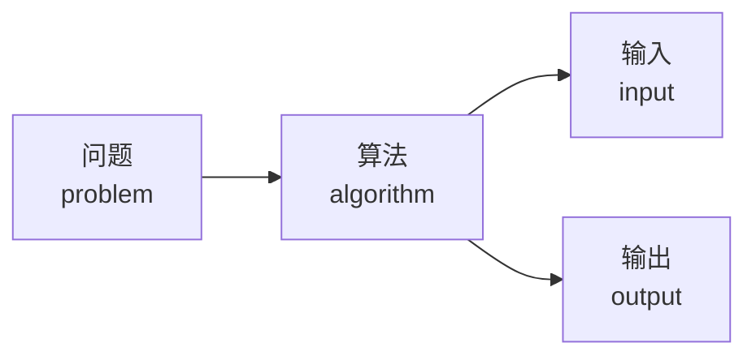

# 1.1 算法及其基本概念

“算法”这个词听起来抽象，其实我们每天都在用它：查字典时先翻到首字母所在的位置，泡茶时先烧水再放茶叶，都是算法。把这类“做事的步骤”说得足够精确、足够机械，让一台只会做加减法和比较的机器也能照着执行，就得到了计算机科学意义上的算法。

## 1.1.1 什么是算法

算法有几种常见的表述，意思完全一致：

- **算法是一系列解决问题的清晰指令**：对于符合一定规范的输入，算法能够在有限时间内获得所要求的输出。
- **算法是解决问题的一种方法或过程**，它由若干条指令组成，是一个**有穷序列**。
- 通俗地说，算法就是“**输入 → 处理 → 输出**”的一条确定的通路。



一个算法应当具备以下五个特征，缺一不可：

| 特征 | 含义 | 反面例子 |
| :--- | :--- | :--- |
| **输入** | 有零个或多个外部量作为算法的输入 | 输入个数必须与问题约定一致 |
| **输出** | 算法产生至少一个量作为输出 | 只计算不返回结果的“过程”不是算法 |
| **确定性** | 组成算法的每条指令清晰、无歧义 | “取一个适当的数”无法执行 |
| **可行性** | 任何计算步骤都可分解为基本的、可执行的操作 | “判断任意程序是否停机”不可行 |
| **有穷性** | 每条指令的执行次数有限，执行每条指令的时间也有限 | `while(true){}` 不是算法 |

::: tip 输入可以是 0 个
“输入有零个或多个”意味着可以没有输入。例如“输出 1 到 100 的和”“打印一个固定图形”都是合法算法。但**输出至少有一个**，否则算法做了事却什么也没留下，无法称为求解。
:::

## 1.1.2 算法与程序

很多同学会把“算法”和“程序”混为一谈。二者关系可以这样理解：

- **算法是思想，程序是实现**。算法是抽象的、与语言无关的解题步骤；程序是算法用某种程序设计语言写成的、可被计算机执行的代码。
- **算法必须有穷，程序可以不有穷**。操作系统、服务器监听程序会一直运行，它们不满足有穷性，因此是程序而不是算法。
- 同一个算法可以有多种程序实现（Java、C++、Python 各写一遍）；同一个程序也可能包含多个算法（排序 + 查找 + 压缩）。

| 比较项 | 算法 | 程序 |
| :--- | :--- | :--- |
| 存在形式 | 抽象的描述 | 具体的代码 |
| 语言依赖 | 无 | 依赖编程语言 |
| 有穷性 | 必须满足 | 可以不满足 |
| 正确性 | 需证明 | 需测试 |
| 关注点 | 思路与效率 | 实现与工程细节 |

## 1.1.3 从同一个问题看算法的多样性

“在序列中查找一个元素”是理解算法设计最合适的入口。同一个问题，可以有完全不同的解法，效率也天差地别。

### 顺序查找

最直接的想法：从头到尾逐个比较。

```plaintext
sequentialSearch(a, x)
// 输入：序列 a，待查找元素 x
// 输出：若找到返回下标，否则返回 -1
i ← 0
while i < a.length and a[i] ≠ x
    i ← i + 1
if i < a.length return i
else return -1
```

无论序列是否有序都可用，最坏情况下要比较 $n$ 次，时间复杂度 $O(n)$。

### 二分查找

如果序列**已经有序**，就可以利用有序性“一次砍掉一半”。

```plaintext
binarySearch(a, x)
// 输入：升序序列 a[0..n-1]，待查找元素 x
// 输出：若找到返回下标，否则返回 -1
l ← 0, r ← n - 1
while l ≤ r
    m ← ⌊(l + r) / 2⌋
    if x = a[m] return m
    if x < a[m] r ← m - 1
    else l ← m + 1
return -1
```

每轮循环区间长度减半，最多比较 $\lceil \log_2 n \rceil + 1$ 次，时间复杂度 $O(\log n)$。

::: info 二分查找的三个追问
1. **递归还是非递归？** 两者都可以。递归写法清晰，但每层调用有栈开销；非递归写法用两个指针，空间 $O(1)$。
2. **序列有重复元素怎么办？** 上面的写法可能返回任意一个匹配位置。若要返回**下标最小**的 $x$，应在 `x = a[m]` 时继续向左收缩（`r ← m - 1`），并记录答案。
3. **边界怎么写才不出错？** 推荐统一使用**左闭右闭**区间 $[l, r]$，循环条件 `l <= r`，收缩时 `l = m + 1`、`r = m - 1`，这样不会死循环。
:::

### 最大公约数：四种解法

求两个正整数 $m,n$ 的最大公约数 $\gcd(m,n)$，可以写出一整套“算法家族”：

| 方法 | 核心思想 | 时间复杂度 | 评价 |
| :--- | :--- | :--- | :--- |
| 连续整数检测 | 从 $\min(m,n)$ 向下试除 | $O(\min(m,n))$ | 直观但慢 |
| 质因数分解 | 分别分解质因数，取公共因子 | 依赖分解算法 | 大整数上不可行 |
| 更相减损 | 大减小，直到相等 | 最坏 $O(\max(m,n))$ | 减法次数可能极多 |
| 欧几里得 | 辗转相除 | $O(\log \min(m,n))$ | 经典高效 |

欧几里得算法的迭代写法只有四行：

```plaintext
euclid(m, n)
while n ≠ 0
    r ← m mod n
    m ← n
    n ← r
return m
```

::: details 为什么欧几里得算法是对的？
设 $m = qn + r$，则 $m$ 与 $n$ 的任意公因数也整除 $r = m - qn$，反之亦然。因此

$$\gcd(m,n) = \gcd(n, r)$$

每轮把问题规模从 $(m,n)$ 缩小到 $(n, r)$，而 $r < n$，规模严格减小，所以必然终止。终止时 $n = 0$，此时 $m$ 就是最大公约数。
:::

这四个算法解决的是**同一个问题**，但设计思路、适用场景与效率完全不同。这正是“算法分析与设计”要研究的内容：不仅要能写出一个算法，还要能判断它是不是足够好。

## 1.1.4 算法的描述方式

| 描述方式 | 优点 | 缺点 | 适用场合 |
| :--- | :--- | :--- | :--- |
| 自然语言 | 易读 | 容易歧义、冗长 | 课堂讲解、思路说明 |
| 流程图 | 直观展示控制流 | 复杂算法图会非常大 | 分支、循环结构的梳理 |
| 伪代码 | 兼顾精确与简洁 | 无统一语法标准 | 教材、论文、考试答题 |
| 程序设计语言 | 可直接运行 | 细节多、依赖语言 | 实验与工程实现 |

本课程约定：**描述算法用伪代码，分析算法用数学，验证算法用程序**。考试中写伪代码不必拘泥语法，但必须让每一步“可执行、无歧义”。

## 1.1.5 一个好算法的标准

除了前面五个“合格线”特征，工程上还希望算法满足：

1. **正确性**：对每一个合法输入都能在有限时间内给出正确答案。正确性需要**证明**，而不是“跑几个样例都对”。
2. **高效性**：时间、空间开销小，最好能给出渐近复杂度。
3. **可读性**：结构清晰，便于他人理解和维护。
4. **健壮性**：对非法输入、极端输入能给出合理处理，而不是崩溃。
5. **通用性**：能处理问题的一类实例，而不是只会解某几个特例。

::: warning 正确性 ≠ 通过测试
测试只能说明“这些样例下是对的”，不能说明“所有输入下都对”。例如二分查找中把 `r ← n - 1` 写成 `r ← n`，大多数样例仍然能过，但在 `x` 大于所有元素时会越界。正确性要靠**循环不变式、数学归纳法、反证法**来论证。
:::
