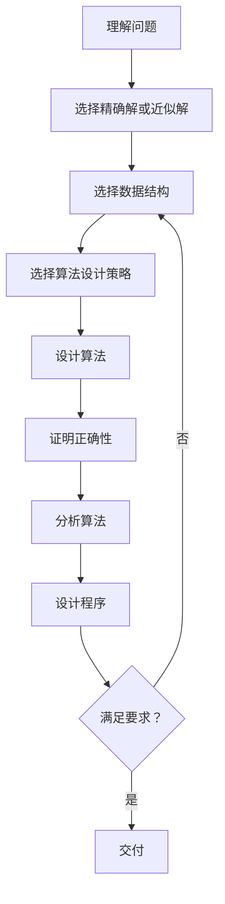

# 1.2 算法求解问题的基本过程

理论数学常常满足于证明“某个问题有解”，或者研究解的性质；而算法关注的是**如何把解真正算出来**。这种对“精确定义的结构化过程”的强调，正是计算机科学区别于其他学科的地方。一个幻方（$n=3$ 时每行、每列、两条对角线之和都为 $15$）在数学家眼里是一个优美的组合对象，在算法设计者眼里则是一个“如何系统地填数”的搜索问题。

这八个步骤并非严格的瀑布流程。实际设计中，分析结果常常迫使我们回到“换数据结构”或“换策略”的阶段重新来过。

## 1.2.1 理解问题

理解问题是全部工作的地基。三种手段最有效：

1. **手工处理小规模实例**。先用纸笔算出 $n=3,4$ 的答案，往往能发现规律。
2. **确定算法需要处理的实例范围**。$n$ 最大到多少？元素是否可重复？图是否连通？这些约束直接决定算法选择。
3. **对问题抽象，用数学语言重新表述**。把“怎么安排”变成“求某个排列/子集，使某个函数最小”。

### 例：单机任务调度

> 有 $n$ 个客户带来 $n$ 项任务，在一台机器上加工，任务 $j$ 的加工时间为 $t_j$。怎样安排加工顺序，使所有客户的总等待时间最少？

把“安排”抽象成数学对象：求 $S=\{1,2,\dots,n\}$ 的一个排列 $i_1,i_2,\dots,i_n$，使

$$\sum_{k=1}^{n}\left(n-k+1\right)t_{i_k}$$

最小。这个式子表示：排在第 $k$ 位的任务，会让它自己和后面 $n-k$ 个任务都多等 $t_{i_k}$ 的时间。显然把 $t$ 小的任务放前面更划算——这就是“短作业优先”策略的由来。

### 例：多人债务清算

> A、B、C、D 四人聚餐平摊费用。实际付款：A 垫付 220 元，B 垫付 80 元，C 没掏钱，D 垫付 140 元。谁该给谁转多少钱？

先算总花费 $220+80+0+140=440$，人均 $110$。于是每人的“净额”为：

| 人 | 实付 | 应摊 | 净额（正为应收） |
| :--- | ---: | ---: | ---: |
| A | 220 | 110 | $+110$ |
| B | 80 | 110 | $-30$ |
| C | 0 | 110 | $-110$ |
| D | 140 | 110 | $+30$ |

问题抽象为：给定一组净额，和为 $0$，求最少的转账笔数使所有人结清。一个可行解是 **C → A 110 元，B → D 30 元**，两笔即可。若按“两两平摊”的直觉去算，往往会产生大量不必要的转账——**抽象层次不同，解的优劣立刻拉开**。

## 1.2.2 精确解还是近似解

| 类型 | 含义 | 典型场景 | 代价 |
| :--- | :--- | :--- | :--- |
| 精确解 | 一定得到最优答案 | $n$ 较小、问题有多项式算法 | 时间/空间可能很高 |
| 近似解 | 得到“足够好”的答案，并给出误差保证 | NP 难问题、实时系统 | 不保证最优 |
| 启发式 | 凭经验规则快速给出可行解 | 超大规模工程问题 | 无理论保证 |

选择哪一种，取决于**问题规模、时间限制与精度要求**三者的平衡。旅行商问题在 $n=20$ 时可以精确求解，在 $n=10^5$ 时只能求近似解。

## 1.2.3 选择数据结构

数据结构是算法的“载体”。同一个策略，换一种存储方式，复杂度可能差一个数量级：

- 顺序表支持 $O(1)$ 随机访问，但插入删除 $O(n)$；
- 链表插入删除 $O(1)$，但查找 $O(n)$；
- 堆支持 $O(\log n)$ 取最值，是贪心与优先队列分支限界的标配；
- 并查集让 Kruskal 算法接近线性；
- 散列表把查找从 $O(\log n)$ 降到期望 $O(1)$。

::: tip 先问“要支持什么操作”
不要一上来就纠结“用数组还是链表”，先列出算法中**最频繁的操作**：是随机访问、尾部插入、取最小值，还是判断连通？出现次数最多的操作，决定了数据结构的选型。
:::

## 1.2.4 选择算法设计策略

本课程介绍的策略可以放在一张“问题地形图”上理解：

| 策略 | 一句话思想 | 解的组织 | 典型问题 |
| :--- | :--- | :--- | :--- |
| 蛮力法 | 枚举所有可能，逐一检验 | 全部候选解 | 顺序查找、冒泡排序、串匹配 |
| 分治法 | 分解—求解—合并，子问题独立 | 递归树 | 归并排序、快速排序、大整数乘法 |
| 动态规划 | 记录重叠子问题的解，自底向上 | 表格（状态） | 矩阵连乘、背包、LCS |
| 贪心法 | 每步取局部最优，不回退 | 决策序列 | 活动安排、Huffman、MST |
| 回溯法 | 深度优先搜索 + 剪枝 | 解空间树（子集树/排列树） | N 皇后、图着色、TSP |
| 分支限界法 | 广度/最佳优先搜索 + 界剪枝 | 活结点表 | 装载、0-1 背包、TSP |
| 遗传算法 | 模拟进化，种群迭代 | 种群（染色体） | 函数优化、组合优化 |

## 1.2.5 设计算法与证明正确性

算法描述常用的三种工具是**自然语言、流程图、伪代码**。课程要求能读懂伪代码，并能把关键步骤补全。

正确性证明的两件主要武器：

- **数学归纳法**：适合递归算法与循环。先证基础情形，再证“若规模 $k$ 成立，则规模 $k+1$ 也成立”。
- **反证法**：假设存在反例，推出矛盾。动态规划的最优子结构性质常用反证法证明。
- **循环不变式**：在循环的每一轮开始前，某个断言都成立。初始化、保持、终止三步，正好对应归纳法的三步。

## 1.2.6 分析算法

分析算法通常看四个维度：

1. **正确性**：是否对所有合法输入都给出正确答案；
2. **效率**：时间、空间复杂度，最好/最坏/平均情况；
3. **简单性**：是否易于理解、实现、调试；
4. **一般性**：能处理多大范围的问题实例。

::: warning 完美是优秀的敌人
追求更好和完美是好事，但完美的代价往往高昂。算法设计与实现是一种**工程行为**，需要在资源有限的前提下，在互相冲突的目标（时间、空间、开发成本、可维护性）之间做权衡。设计者的时间本身也是一种资源。
:::

## 1.2.7 程序实现

把伪代码翻译成程序，并不是“照抄”那么简单。至少要处理：

- **边界与越界**：空数组、单元素、下标从 $0$ 还是 $1$ 开始；
- **数据类型与溢出**：`int` 是否够大，浮点误差是否会累积；
- **递归深度**：递归层数过深会导致栈溢出，需要改成迭代或显式栈；
- **输入规模与常数因子**：$O(n\log n)$ 的算法在小数据上未必快过 $O(n^2)$。

## 1.2.8 常见问题类型

| 类型 | 典型问题 | 常用策略 |
| :--- | :--- | :--- |
| 排序 | 选择、冒泡、归并、快速、堆排序 | 蛮力、分治、堆 |
| 查找 | 顺序查找、二分查找、散列查找 | 蛮力、分治、减治 |
| 字符串处理 | 模式匹配、编辑距离、最长公共子序列 | 蛮力、动态规划 |
| 图的问题 | 最短路、最小生成树、连通性、着色 | 贪心、动态规划、回溯 |
| 组合问题 | 排列、组合、子集、背包、TSP | 回溯、分支限界、动态规划、遗传 |
| 几何问题 | 最近点对、凸包、线段相交 | 分治、蛮力 |
| 数值问题 | 方程求根、数值积分、矩阵运算 | 迭代、分治 |
| 方程问题 | 线性方程组、非线性方程 | 消元、迭代、二分 |

## 1.2.9 算法的边界

虽然实际计算中绝大多数问题都能用算法解决，但**并不是每个问题都能用算法解决**。停机问题、希尔伯特第十问题等已经被证明不存在求解算法。这提醒我们：

> 算法设计的第一步，是确认问题本身是“可计算的”；第二步，才是追求“算得快”。

对可计算的问题，也还要区分“有多难”：存在多项式算法的属于 **P 类**，能在多项式时间内验证解的属于 **NP 类**，而 NP 完全问题目前被认为不存在多项式算法。面对 NP 难问题，工程上的选择通常是**近似算法、启发式算法或分支限界**——这也正是本课程后半程的内容。
