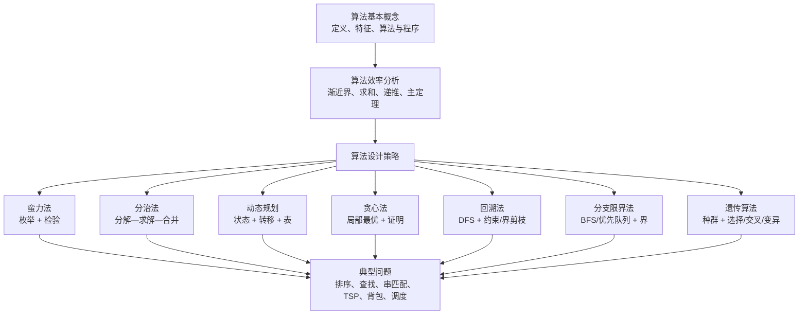

# 10.1 知识地图与考点梳理

## 10.1.1 一张图看完整门课



## 10.1.2 七种策略横向对比

| 策略 | 一句话思想 | 适用条件 | 解的组织 | 时间复杂度 | 典型问题 |
| :--- | :--- | :--- | :--- | :--- | :--- |
| 蛮力法 | 枚举所有可能，逐一检验 | 几乎无限制 | 候选解集合 | 指数/多项式 | 顺序查找、冒泡、串匹配 |
| 分治法 | 分解—求解—合并 | 可分解、可合并、子问题独立 | 递归树 | 由递推决定 | 归并/快排、大整数、最近点对 |
| 动态规划 | 记录重叠子问题，自底向上 | 最优子结构、无后效性、重叠子问题 | 表格（状态） | 状态数 × 转移 | 矩阵连乘、LCS、背包 |
| 贪心法 | 每步取局部最优，不回退 | 贪心选择性质、最优子结构 | 决策序列 | 通常 $O(n\log n)$ | 活动安排、Huffman、MST |
| 回溯法 | DFS + 约束/界剪枝 | 多米诺性质 | 解空间树 | 最坏指数 | N 皇后、TSP、最大团 |
| 分支限界法 | BFS/优先队列 + 界剪枝 | 多米诺性质、界可计算 | 活结点表 | 最坏指数 | 装载、0-1 背包、TSP |
| 遗传算法 | 模拟进化，种群迭代 | 无特殊要求，适合黑箱 | 种群（染色体） | $O(TMn)$ | 函数优化、TSP、调度 |

## 10.1.3 重点一：动态规划

### 必须掌握的四个问题

| 问题 | 状态 | 转移方程 | 复杂度 |
| :--- | :--- | :--- | :--- |
| 矩阵连乘 | $m[i][j]$：$A[i:j]$ 的最少乘法次数 | $\min_k\{m[i][k]+m[k+1][j]+p_{i-1}p_kp_j\}$ | $O(n^3)$ |
| LCS | $c[i][j]$：$X_i,Y_j$ 的 LCS 长度 | 相等 $c[i-1][j-1]+1$；否则 $\max\{c[i-1][j],c[i][j-1]\}$ | $O(mn)$ |
| 0-1 背包 | $m(i,j)$：前 $i$ 件、容量 $j$ 的最优值 | $\max\{m(i-1,j),m(i-1,j-w_i)+v_i\}$ | $O(nc)$ |
| 最大子段和 | $b[j]$：以 $a_j$ 结尾的最大和 | $\max\{b[j-1]+a_j,a_j\}$ | $O(n)$ |

### 还要会推的

- 凸多边形最优三角剖分：与矩阵连乘同构；
- 图像压缩：$s[i]=\min_{k\le256}\{s[i-k]+k\cdot\text{bmax}\}+11$；
- 最优二叉搜索树：$m[i][j]=\min_k\{m[i][k-1]+m[k+1][j]\}+w[i][j]$；
- 投资问题：$F(k,x)=\max_{0\le y\le x}\{F(k-1,x-y)+f_k(y)\}$；
- 流水作业调度：$T(S,t)$ 的递推 + Johnson 贪心；
- 最长递增子序列、序列比对、电路布线：与 LCS 同构。

### 动态规划的答题步骤

1. **定义状态**：$dp[\cdot]$ 表示什么子问题；
2. **写转移**：当前状态由哪些更小的状态得到；
3. **定边界**：最小子问题的值；
4. **定顺序**：按什么顺序填表（区间长度、物品编号、容量从小到大）；
5. **给答案**：最终答案对应哪个状态；
6. **构造解**：是否需要额外的决策表/父指针。

::: warning 动态规划最常见的失分点
- 状态定义含糊，说不清“包含/不包含第 $i$ 个”；
- 转移方程漏掉某个决策；
- 边界写错（$i=0$ 或 $j=0$）；
- 忘记构造最优解；
- 复杂度分析只写“$O(n^2)$”，不说明状态数与转移代价。
:::

## 10.1.4 重点二：回溯法

### 五个必背模板

| 问题 | 解空间树 | 约束 | 界 |
| :--- | :--- | :--- | :--- |
| N 皇后 | $n$ 叉树 | 列、对角线不冲突 | 无（求所有解） |
| 图 $m$ 着色 | $m$ 叉树 | 相邻顶点不同色 | 无 |
| 货郎担 | 排列树 | 有边、不重复 | $cc+\text{边}<bestc$ |
| 装载 | 子集树 | $cw+w_i\le c$ | $cw+r>bestw$ |
| 0-1 背包 | 子集树 | $cw+w_i\le c$ | $cv+\text{剩余上界}>bestp$ |
| 最大团 | 子集树 | 与前团全相邻 | $cn+n-i>bestn$ |

### 通用递归框架

```text
void backtrack(int t) {
    if (t > n) output(x);
    else
        for (int i = f(n, t); i <= g(n, t); i++) {
            x[t] = h(i);
            if (constraint(t) && bound(t))
                backtrack(t + 1);
        }
}
```

### 三个必答点

1. **解向量与显式/隐式约束**；
2. **剪枝条件**（约束函数、界函数）；
3. **复杂度**（最坏 $O(n^n)$、$O(n!)$、$O(2^n)$，空间 $O(n)$）。

## 10.1.5 重点三：分支限界法

### 核心对比

| 维度 | 回溯法 | 分支限界法 |
| :--- | :--- | :--- |
| 搜索 | 深度优先 | 广度/最佳优先 |
| 活结点 | 递归栈 | 队列/优先队列 |
| 目标 | 所有解/一个解 | 一个最优解 |
| 空间 | $O(n)$ | 最坏指数 |
| 剪枝 | 约束 + 界 | 约束 + 界 |

### 界的用法

- 极大化：$UB\le cBest$ 剪枝；$UB$ 越小越紧；
- 极小化：$LB\ge cBest$ 剪枝；$LB$ 越大越紧；
- 优先队列：极大化按 $UB$ 降序，极小化按 $LB$ 升序；
- **第一个被取出的叶子就是最优解**（按上述顺序）。

### 必会问题

| 问题 | 界 |
| :--- | :--- |
| 装载 | $UB=cw+r$ |
| 0-1 背包 | $UB=cv+\text{剩余分数背包}$ |
| 货郎担 | 矩阵归约 / 两最小边 |
| 最大团 | $UB=cn+n-i+1$ |
| 批作业调度 | $LB=sf_2+\text{剩余理想完成时间和}$ |

## 10.1.6 次重点：分治、贪心、遗传

### 分治

- 四个适用条件；
- 递推 $T(n)=aT(n/b)+f(n)$ 与主定理；
- 典型：归并/快排、二分、大整数、Strassen、最近点对、棋盘覆盖；
- 关键：**合并代价**与**子问题独立性**。

### 贪心

- 两个条件：贪心选择性质、最优子结构；
- 证明：交换论证；
- 典型：活动安排、分数背包、最优装载、Huffman、Prim/Kruskal、Dijkstra、Johnson；
- 反例：0-1 背包、硬币找零。

### 遗传算法

- 五个要素：编码、初始种群、适应度、选择、交叉、变异；
- 轮盘赌：$p_i=F_i/\sum F_j$；
- 参数：$M,P_c,P_m,T$；
- TSP：排列编码、OX/PMX、交换/逆转变异、修复；
- 特点：群体搜索、不依赖梯度、无最优性保证。

## 10.1.7 复杂度速记

| 算法 | 时间 | 空间 |
| :--- | :--- | :--- |
| 顺序查找 | $O(n)$ | $O(1)$ |
| 二分查找 | $O(\log n)$ | $O(1)$ |
| 选择/冒泡排序 | $O(n^2)$ | $O(1)$ |
| 归并排序 | $O(n\log n)$ | $O(n)$ |
| 快速排序 | 平均 $O(n\log n)$，最坏 $O(n^2)$ | $O(\log n)$ |
| 线性选择 | $O(n)$ | $O(\log n)$ |
| 矩阵连乘 DP | $O(n^3)$ | $O(n^2)$ |
| LCS | $O(mn)$ | $O(mn)$ |
| 0-1 背包 DP | $O(nc)$ | $O(nc)$ / $O(c)$ |
| 最近点对 | $O(n\log n)$ | $O(n)$ |
| 棋盘覆盖 | $O(4^k)$ | $O(4^k)$ |
| 回溯/分支限界 | 最坏指数 | $O(n)$ / 指数 |

## 10.1.8 复习路线建议

::: tip 三天复习法
**第一天：基础与分治**
- 过一遍算法概念、五个特征、算法与程序的区别；
- 掌握渐近记号、主定理、常见递推；
- 手推归并/快排/二分/大整数的递推。

**第二天：动态规划（重点）**
- 默写矩阵连乘、LCS、0-1 背包、最大子段和的方程与代码；
- 手算一个小规模的 DP 表；
- 理解“同构”：区间划分、双序列对齐。

**第三天：回溯与分支限界（重点）+ 贪心/遗传**
- 默写回溯框架与五个模板；
- 画出一个分支限界的小搜索树，标出 UB/LB 与剪枝；
- 过一遍贪心的交换论证与反例；
- 记遗传算法的五要素与轮盘赌公式。
:::

::: warning 考场提醒
- **不要留白**：不会也要写出解向量、约束、思路，过程分很值钱；
- **先易后难**：选择填空快速过，把时间留给算法设计；
- **写复杂度**：每个算法设计题最后都要分析时间/空间；
- **检查边界**：$n=0,1$、空数组、单元素、全负数是常见坑。
:::
