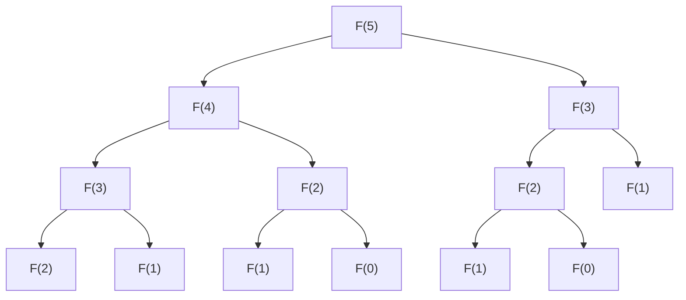

# 2.4 递归、非递归与经验分析

递归是分治法、回溯法、动态规划（记忆化形式）共同的实现基础。它让代码几乎与数学定义一一对应，但也可能带来栈开销与重复计算。理解“什么时候该递归、什么时候该改写为迭代”，是算法实现能力的分水岭。

## 2.4.1 递归的定义与结构

一个递归算法必须包含两部分：

1. **递归基（边界条件）**：问题规模足够小时，直接给出答案；
2. **递归步（递推关系）**：把原问题化为规模更小的同类子问题，并用子问题的解组合出原问题的解。

以阶乘为例：

$$n!=\begin{cases}1, & n=0\\ n\cdot(n-1)!, & n>0\end{cases}$$

```java
// 递归实现
int factorial(int n) {
    if (n == 0) return 1;
    return n * factorial(n - 1);
}

// 非递归实现
int factorial(int n) {
    int fn = 1;
    for (int i = 2; i <= n; i++) fn = fn * i;
    return fn;
}
```

两者时间复杂度都是 $\Theta(n)$，但递归版本每层都要保存返回地址、参数与局部变量，空间 $O(n)$；非递归版本只用常数个变量，空间 $O(1)$，且没有函数调用开销，实际运行更快。

## 2.4.2 斐波那契数列：重复计算的代价

$$F(n)=\begin{cases}0, & n=0\\ 1, & n=1\\ F(n-1)+F(n-2), & n>1\end{cases}$$

最直接的递归实现：

```java
int fibonacci(int n) {
    if (n <= 1) return n;
    return fibonacci(n - 1) + fibonacci(n - 2);
}
```

它为什么慢？看 $F(5)$ 的调用树：



$F(3)$ 被计算了两次，$F(2)$ 被计算了三次。规模越大，重复越严重。设调用次数为 $C(n)$，则

$$C(n)=C(n-1)+C(n-2)+1,\qquad C(0)=C(1)=1$$

其解与斐波那契同阶，约为 $2F(n)-1$，而

$$F(n)=\frac{1}{\sqrt5}\left[\left(\frac{1+\sqrt5}{2}\right)^n-\left(\frac{1-\sqrt5}{2}\right)^n\right]\approx\frac{\varphi^n}{\sqrt5}$$

其中 $\varphi=(1+\sqrt5)/2\approx1.618$。因此递归版的时间复杂度是 $\Theta(\varphi^n)$，**指数级**。

### 非递归实现

```java
int fibonacci(int n) {
    int a = 0, b = 1;
    for (int i = 0; i < n; i++) {
        int t = a + b;
        a = b;
        b = t;
    }
    return a;
}
```

时间 $O(n)$，空间 $O(1)$。若用数组滚动，也可以写成 `a[i % 2] = a[(i-1) % 2] + a[(i-2) % 2]`，空间仍是 $O(1)$。

::: tip 从递归到动态规划
斐波那契是“重叠子问题”最纯粹的例子。把已经算过的 $F(k)$ 存进数组，递归时先查表，就把指数级降到了 $O(n)$——这就是**记忆化搜索**；若改为从小到大地填表，就是**动态规划**。第 5 章会系统展开这一思想。
:::

## 2.4.3 递归一定能有非递归写法吗？

不一定。

- **尾递归**可以机械地改写为循环。若递归调用是函数的最后一步操作，编译器也能自动优化（尾调用优化）。
- **一般递归**可以用**显式栈**模拟系统调用栈，理论上总能改写，但代码会变得复杂。
- **有些函数只有递归定义**，没有已知的初等闭式或简单迭代形式。典型例子是 Ackermann 函数：

$$A(m,n)=\begin{cases}
n+1, & m=0\\
A(m-1,1), & m>0,\ n=0\\
A(m-1,A(m,n-1)), & m>0,\ n>0
\end{cases}$$

它的增长极其迅猛（$A(4,2)$ 已经是一个约 $2^{65536}$ 量级的数），不存在用基本运算直接展开的简单非递归定义。

::: warning 递归不等于低效
递归的“低效”来自**重复子问题**与**调用开销**，而不是递归本身。归并排序、快速排序、二分查找都用递归，效率依然优秀。判断标准是：子问题是否重叠、递归深度是否可控。
:::

## 2.4.4 递归与非递归的比较

| 维度 | 递归 | 非递归（迭代） |
| :--- | :--- | :--- |
| 代码可读性 | 与数学定义一致，简洁 | 通常需要手动维护状态 |
| 时间开销 | 有函数调用、参数压栈开销 | 无调用开销，常数更小 |
| 空间开销 | 递归栈 $O(\text{深度})$ | 通常 $O(1)$，也可用显式栈 |
| 重复计算风险 | 朴素递归可能指数级 | 一般不会 |
| 栈溢出风险 | 深度大时可能溢出 | 无 |
| 适用场景 | 分治、回溯、树/图遍历 | 线性递推、尾递归、深度极大 |

::: tip 工程建议
- 深度可能超过 $10^4$ 时，优先考虑迭代或显式栈；
- 子问题重叠时，先想记忆化，再想递推；
- 递归函数尽量写成**尾递归**形式，便于优化；
- 不要把“递归”当作“分治”的同义词：递归是实现手段，分治是设计思想。
:::

## 2.4.5 经验与实验分析

数学分析并非万能。许多算法（尤其是平均情况、综合性算法、带复杂常数因子的算法）很难精确求解，这时需要**实验与经验分析**。

### 两种基本手段

**（1）计数法**：在程序里插入计数器，统计基本操作的执行次数。

```java
long comparisons = 0;
for (int i = 0; i < n - 1; i++)
    for (int j = i + 1; j < n; j++) {
        comparisons++;
        if (a[i] == a[j]) return false;
    }
```

优点是**与机器无关**，能直接验证复杂度阶；缺点是需要修改代码，且“基本操作”的选择带有主观性。

**（2）计时法**：测量真实运行时间。

```java
long start = System.nanoTime();
sort(a);
long elapsed = System.nanoTime() - start;
```

优点是直观、贴近真实体验；缺点是受机器、编译器、缓存、GC 影响大，必须控制实验条件。

### 实验设计的注意事项

1. **固定环境**：同一台机器、同一编译器优化选项、同一 JVM 参数；
2. **预热**：Java 有 JIT 编译，前几次运行明显偏慢，应先跑若干轮丢弃；
3. **多次取平均**：每組实验重复 $5\sim10$ 次，报告中位数或平均值；
4. **规模成倍增加**：取 $n=2^k$，观察时间如何变化。若 $n$ 翻倍时间也翻倍，倾向线性；翻四倍，倾向平方；增加一个固定量，倾向对数；
5. **输入要有代表性**：随机、升序、降序、大量重复各测一组，避免“只测最好情况”；
6. **画图拟合**：在双对数坐标下，若点近似落在斜率为 $k$ 的直线上，则复杂度约为 $\Theta(n^k)$。

### 一个典型的实验结论表

| 算法 | $n=10^3$ | $n=10^4$ | $n=10^5$ | 拟合阶 |
| :--- | ---: | ---: | ---: | :--- |
| 插入排序（随机） | 0.6 ms | 62 ms | 6.3 s | $\Theta(n^2)$ |
| 归并排序 | 0.4 ms | 5 ms | 60 ms | $\Theta(n\log n)$ |
| 快速排序（随机） | 0.3 ms | 3.5 ms | 42 ms | $\Theta(n\log n)$ |
| 二分查找 | 0.001 ms | 0.001 ms | 0.002 ms | $\Theta(\log n)$ |

> 表中数据仅用于说明“规模翻十倍，时间如何变化”，具体数值会随机器不同而不同。

::: warning 实验不能代替证明
实验能验证“在这组数据上表现如何”，但不能证明“对所有输入都正确/都高效”。正确性靠证明，复杂性靠推导，实验只是二者的补充与校验。
:::
