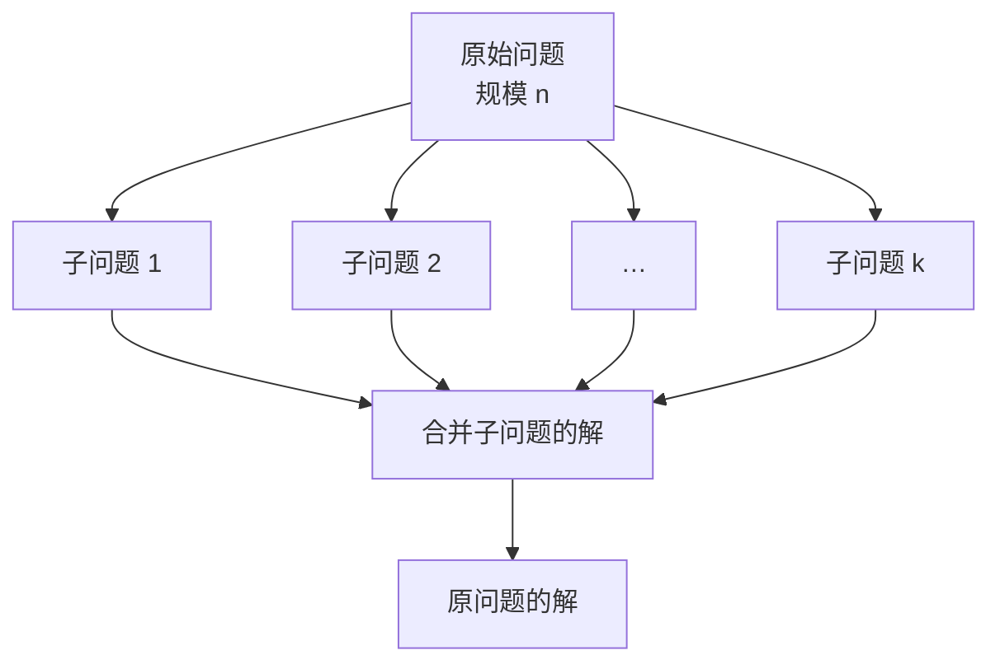

# 4.1 分治法的基本思想与复杂性

## 4.1.1 从“问题越小越好办”说起

求解问题算法的复杂性，一般都与问题规模相关：**问题规模越小，越容易处理**。如果能把一个大问题拆成若干个规模较小、结构相同的子问题，分别求解后再把结果合并起来，就得到了分治法的基本思路。

> 分治法将一个难以直接解决的大问题，分解为规模较小的相同子问题，直至这些子问题容易直接求解，并且可以利用这些子问题的解求出原问题的解。各个击破，分而治之。



分治法产生的子问题一般是原问题的**较小模式**，这为使用递归提供了天然便利。因此**递归是分治法最常用的实现技术**，但分治法不等于递归：有些分治算法可以用循环实现（如自底向上的归并），递归只是描述“分治结构”最自然的方式。

## 4.1.2 适用条件

分治法所能解决的问题，一般具有以下四个特征：

1. **可缩小**：问题的规模缩小到一定程度就可以容易地解决；
2. **可分解**：问题可以分解为若干个规模较小的**相同**问题；
3. **可合并**：利用子问题的解可以合并出原问题的解；
4. **子问题独立**：分解出的各个子问题相互独立，不包含公共的子问题。

::: warning 第四条决定效率
第 4 条直接关系到分治法的效率。如果子问题不独立，分治法会**重复求解公共子问题**，做大量无用功。这时虽然仍可用分治，但通常改用**动态规划**更合适。

例如斐波那契数列：$F(n)=F(n-1)+F(n-2)$ 形式上满足“可分解”，但两个子问题大量重叠，朴素分治的时间复杂度是指数级的；改成记忆化或递推后降到 $O(n)$。
:::

## 4.1.3 求解步骤

分治法的求解过程由三个阶段组成：

- **划分（Divide）**：把规模为 $n$ 的原问题划分为 $k$ 个规模较小的子问题，尽量使这 $k$ 个子问题的规模大致相同；
- **求解（Conquer）**：递归地求解各个子问题；若子问题规模足够小，则直接求解；
- **合并（Merge）**：把各个子问题的解合并为原问题的解。合并的代价因问题而异，分治算法的有效性很大程度上取决于合并的实现。

通用伪代码：

```text
divide-and-conquer(P)
if |P| ≤ n0
    adhoc(P)                    // 直接解决小规模问题
将 P 分解为较小的子问题 P1, P2, …, Pk
for i ← 1 to k
    yi ← divide-and-conquer(Pi) // 递归求解
return merge(y1, y2, …, yk)     // 合并
```

::: tip 设计分治算法的四个决策
1. **怎么分**：按位置对半、按数值范围、按位数、按象限……
2. **分多细**：子问题规模多大时停止递归（阈值 $n_0$）？
3. **怎么合**：合并的代价能否控制在 $O(n)$ 或 $O(n\log n)$？
4. **子问题是否独立**：若重叠，考虑动态规划。
:::

## 4.1.4 复杂性分析

分治算法的时间复杂度通常满足递推方程

$$T(n)=\begin{cases}
O(1), & n=1\\
aT\left(\dfrac{n}{b}\right)+f(n), & n>1
\end{cases}$$

其中 $a$ 是子问题个数，$n/b$ 是子问题规模，$f(n)$ 是划分与合并的代价。

设 $n=b^k$，逐层展开：

$$T(n)=a^{k}T(1)+\sum_{j=0}^{k-1}a^{j}f\left(\frac{n}{b^{j}}\right),\qquad k=\log_b n$$

### 三种典型情形

| 情形 | 条件 | 解 | 直观解释 |
| :--- | :--- | :--- | :--- |
| 子问题占主导 | $f(n)=O(n^{\log_b a-\varepsilon})$ | $\Theta(n^{\log_b a})$ | 叶子多，合并便宜 |
| 均衡 | $f(n)=\Theta(n^{\log_b a})$ | $\Theta(n^{\log_b a}\log n)$ | 每层代价相同 |
| 合并占主导 | $f(n)=\Omega(n^{\log_b a+\varepsilon})$ | $\Theta(f(n))$ | 合并贵，叶子便宜 |

这正是主定理的内容。用“递归树”理解：树有 $\log_b n$ 层，第 $j$ 层有 $a^j$ 个结点，每个结点代价 $f(n/b^j)$，整层代价为 $a^j f(n/b^j)$。比较每层代价与叶子总代价 $n^{\log_b a}$，谁大听谁的。

::: info 为什么只讨论 $n=b^k$？
递推方程的解只给出 $n$ 等于 $b$ 的方幂时 $T(n)$ 的值。但若认为 $T(n)$ 足够平滑（通常假定单调上升），那么当 $b^i\le n<b^{i+1}$ 时，$T(b^i)\le T(n)<T(b^{i+1})$，由 $n=b^i$ 时的结论可以估计任意 $n$ 的增长速度。因此这种限制不影响渐近阶。
:::

## 4.1.5 分治、减治与动态规划

三个概念容易混淆，用一张表厘清：

| 范式 | 子问题个数 | 子问题规模 | 子问题关系 | 典型算法 |
| :--- | :--- | :--- | :--- | :--- |
| 分治 | 多个（通常 $\ge2$） | 约为原规模的 $1/b$ | 独立 | 归并排序、最近点对 |
| 减治 | 一个 | 略小于原规模 | 无关 | 二分查找、快速选择 |
| 动态规划 | 多个 | 各种规模 | **重叠** | 矩阵连乘、背包 |

二分查找严格来说属于**减治法**（decrease-and-conquer）：每轮只保留一个子问题，规模减半。但教材常把它放在分治一章讲，因为它同样体现了“缩小规模”的思想。

## 4.1.6 分治法为什么能降低复杂度

分治法降低复杂度的本质，是**把“线性地处理每个元素”变成“对数层地处理”**。以归并排序为例：

- 朴素排序每轮只能确定一个元素的位置，需要 $n$ 轮，每轮 $O(n)$，共 $O(n^2)$；
- 归并排序把序列分成两半，递归深度只有 $\log n$，每层合并总代价 $O(n)$，共 $O(n\log n)$。

常见的“降复杂度手段”有三类：

1. **代数变换，减少子问题个数**：大整数乘法从 $4$ 次乘法降到 $3$ 次，矩阵乘法从 $8$ 次降到 $7$ 次；
2. **利用中间结果**：快速排序的分区、归并的已有序片段；
3. **数据预处理**：最近点对先按 $x$ 排序、再按 $y$ 归并，避免每层重复排序。

::: warning 分治不一定更快
对“求 $n$ 个数之和”这类问题，分治的递推是 $T(n)=2T(n/2)+O(1)=O(n)$，与顺序累加同阶，却多了递归开销。分治的收益来自**子问题规模的缩减**或**合并代价的降低**；若两者都没有改善，分治只是“看起来优雅”。
:::
