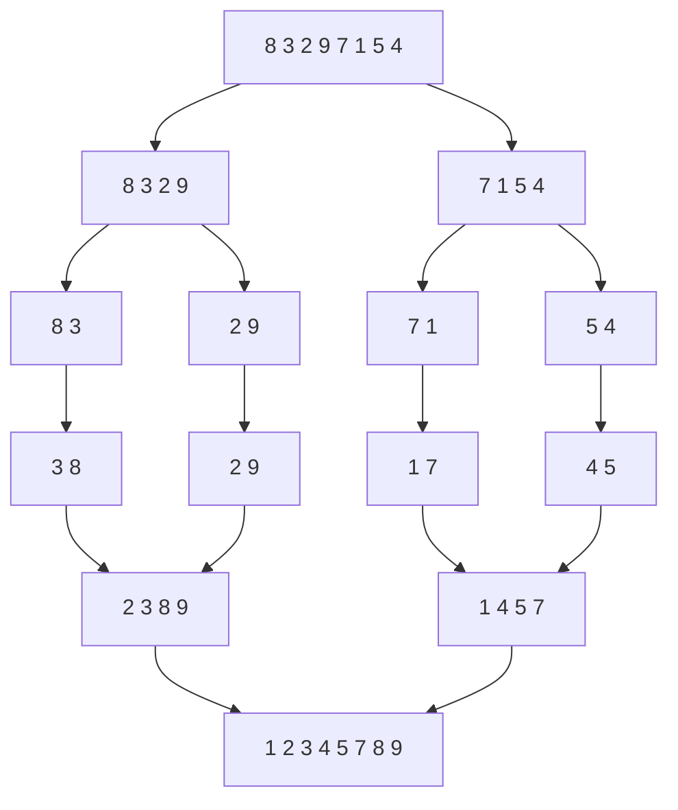
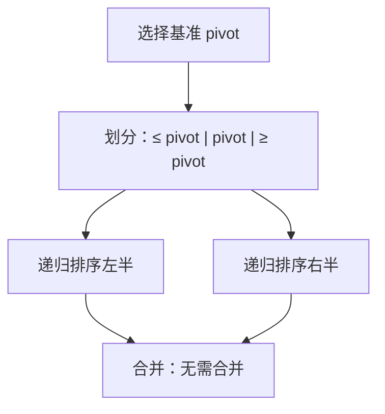

# 4.4 归并排序、快速排序与第 k 小元素

排序是分治法最经典的应用场景。归并排序与快速排序分别代表两种截然不同的分治思路：**先分后合**与**先合后分**（先划分再递归）。

## 4.4.1 归并排序

### 思想

将待排序序列分成大小大致相同的两个子序列，分别排序，再把两个**有序子序列合并**成一个有序序列。



### 算法

```text
mergeSort(A, l, r)
if l ≥ r return
m ← (l + r) / 2
mergeSort(A, l, m)
mergeSort(A, m+1, r)
merge(A, l, m, r)

merge(A, l, m, r)
// 合并两个有序段 A[l..m] 与 A[m+1..r]
i ← l, j ← m+1, k ← 0
while i ≤ m and j ≤ r
    if A[i] ≤ A[j]  B[k++] ← A[i++]
    else           B[k++] ← A[j++]
while i ≤ m B[k++] ← A[i++]
while j ≤ r B[k++] ← A[j++]
copy B[0..k-1] back to A[l..r]
```

```java
void mergeSort(int[] a, int l, int r) {
    if (l >= r) return;
    int m = (l + r) >>> 1;
    mergeSort(a, l, m);
    mergeSort(a, m + 1, r);
    merge(a, l, m, r);
}

void merge(int[] a, int l, int m, int r) {
    int[] b = new int[r - l + 1];
    int i = l, j = m + 1, k = 0;
    while (i <= m && j <= r) b[k++] = (a[i] <= a[j]) ? a[i++] : a[j++];
    while (i <= m) b[k++] = a[i++];
    while (j <= r) b[k++] = a[j++];
    System.arraycopy(b, 0, a, l, b.length);
}
```

::: tip 稳定性从哪来？
合并时用 `a[i] <= a[j]` 而不是 `<`：当左右元素相等时，**优先取左边的**，这样左半部分的相同元素一定排在右半部分之前，排序稳定。若改成 `<`，稳定性被破坏。
:::

### 复杂度

- **时间**：合并两个长度约为 $n/2$ 的有序段需要 $O(n)$ 次比较，故

$$T(n)=2T\left(\frac{n}{2}\right)+O(n)\quad\Longrightarrow\quad T(n)=\Theta(n\log n)$$

最好、最坏、平均都是 $\Theta(n\log n)$。

- **空间**：合并需要长度为 $n$ 的辅助数组，$S(n)=O(n)$。
- **比较次数**：最坏约 $n\log_2 n-n+1$，非常接近基于比较的排序理论下界 $\lceil\log_2(n!)\rceil$。

### 特点与优化

| 优点 | 缺点 |
| :--- | :--- |
| 最坏也是 $O(n\log n)$ | 需要 $O(n)$ 辅助空间 |
| 稳定排序 | 对小数组有递归与复制开销 |
| 适合链表、外部排序 | 没有利用输入已有的有序性 |

- **自然归并**：先扫描一遍，把已经有序的连续段（runs）找出来，再两两合并。对“几乎有序”的数据可以接近 $O(n)$。
- **小数组切换插入排序**：当子数组长度小于阈值（如 $16$）时直接插入排序，减少递归开销。
- **原地归并**：可以把空间降到 $O(1)$，但实现复杂且常数很大，实际很少使用。

## 4.4.2 快速排序

### 思想

选取一个基准元素（pivot），通过一趟**划分（partition）**把数组分成两部分：左边都不大于基准，右边都不小于基准，基准归位。然后对左右两部分递归排序。



### 算法

```text
quickSort(A, l, r)
if l ≥ r return
p ← partition(A, l, r)
quickSort(A, l, p-1)
quickSort(A, p+1, r)

partition(A, l, r)        // Lomuto 划分
pivot ← A[r]
i ← l - 1
for j ← l to r-1
    if A[j] ≤ pivot
        i ← i + 1
        swap A[i], A[j]
swap A[i+1], A[r]
return i + 1
```

```java
void quickSort(int[] a, int l, int r) {
    if (l >= r) return;
    int p = partition(a, l, r);
    quickSort(a, l, p - 1);
    quickSort(a, p + 1, r);
}

int partition(int[] a, int l, int r) {
    int pivot = a[r], i = l - 1;
    for (int j = l; j < r; j++)
        if (a[j] <= pivot) {
            i++;
            int t = a[i]; a[i] = a[j]; a[j] = t;
        }
    int t = a[i + 1]; a[i + 1] = a[r]; a[r] = t;
    return i + 1;
}
```

### 复杂度

**最好情况**：每次划分都均匀，$T(n)=2T(n/2)+O(n)=\Theta(n\log n)$。

**最坏情况**：每次划分都极不平衡（如数组已有序、基准取末尾），$T(n)=T(n-1)+O(n)=\Theta(n^2)$。

**平均情况**：设基准最终落在第 $k$ 位，则

$$T(n)=\frac{1}{n}\sum_{k=1}^{n}\bigl[T(k-1)+T(n-k)\bigr]+O(n)$$

解得 $T(n)=\Theta(n\log n)$。

**空间**：递归栈平均 $O(\log n)$，最坏 $O(n)$。

::: warning 快速排序不稳定
划分过程中的交换会跨越相同元素，破坏相对次序。例如 $[2_a,2_b,1]$ 以 $1$ 为基准划分后可能变成 $[1,2_b,2_a]$。若需要稳定排序，应使用归并排序。
:::

### 优化手段

| 优化 | 做法 | 解决的问题 |
| :--- | :--- | :--- |
| 随机基准 | `swap(a[r], a[random(l,r)])` | 避免有序输入退化为 $O(n^2)$ |
| 三数取中 | 取首、中、尾的中位数作基准 | 降低极端划分概率 |
| 三路划分 | 分成 `< pivot`、`= pivot`、`> pivot` 三段 | 大量重复元素时接近 $O(n)$ |
| 小数组插入排序 | 长度小于阈值时切换 | 减少递归开销 |
| 尾递归优化 | 先递归较短的一侧，较长的一侧循环 | 栈深度降到 $O(\log n)$ |

::: tip 三路划分为什么重要
当数组中大量元素等于基准时，Lomuto 划分会把相等元素全部分到一侧，导致划分极不平衡。三路划分（荷兰国旗问题）一次把数组分成三段，相等元素直接归位，不再参与递归。对“所有元素都相同”的输入，复杂度从 $O(n^2)$ 降到 $O(n)$。
:::

## 4.4.3 第 k 小元素

问题：给定 $n$ 个元素的线性序集和一个整数 $k$（$1\le k\le n$），找出第 $k$ 小的元素。

### 直接排序

排序后取 $A[k-1]$，时间 $O(n\log n)$。但求第 $k$ 小并不需要全体有序，可以更快。

### 快速选择（随机化）

借用快速排序的划分：划分后基准落在第 $p$ 位，设左半部分（含基准）有 $j=p-l+1$ 个元素：

- 若 $k=j$，基准就是答案；
- 若 $k<j$，答案在左半部分；
- 若 $k>j$，答案在右半部分，且是右半部分的第 $k-j$ 小。

```java
int randomizedSelect(int[] a, int l, int r, int k) {
    if (l == r) return a[l];
    int p = randomPartition(a, l, r);
    int j = p - l + 1;
    if (k == j) return a[p];
    if (k < j) return randomizedSelect(a, l, p - 1, k);
    return randomizedSelect(a, p + 1, r, k - j);
}
```

**平均复杂度**：每次期望淘汰一半左右，$T(n)=T(n/2)+O(n)$，故 $O(n)$。

**最坏复杂度**：每次划分极不平衡，$T(n)=T(n-1)+O(n)=O(n^2)$。

### 线性时间选择（最坏 $O(n)$）

要让最坏情况也是 $O(n)$，关键在于**选择一个足够好的基准**，使划分后两侧都不至于太小。算法如下：

1. 将 $n$ 个元素每 $5$ 个一组，共 $\lceil n/5\rceil$ 组；
2. 对每组排序，取出每组的中位数；
3. 递归地求出这些中位数的中位数 $x$；
4. 以 $x$ 为基准划分，递归处理相应一侧。

```text
select(A, l, r, k)
if r - l < 75
    排序 A[l..r]，返回第 k 小
将 A[l..r] 每 5 个一组，组内排序，取中位数
x ← select(中位数数组, 1, ⌈n/5⌉, ⌈⌈n/5⌉/2⌉)
以 x 为基准划分，设 x 的位置为 p
if k = p return x
if k < p return select(A, l, p-1, k)
else return select(A, p+1, r, k - p + l - 1)
```

::: details 为什么是 $T(n/5)+T(7n/10)+O(n)$？
- 求中位数的中位数：$T(n/5)$；
- 划分后，至少有多少元素确定在 $x$ 的某一侧？每组 $5$ 个元素中，除中位数外至少有 $2$ 个元素大于等于本组中位数。有一半的组，其中位数 $\ge x$，这些组每组至少有 $3$ 个元素 $\ge x$。因此大于等于 $x$ 的元素至少有

$$\frac{1}{2}\cdot\frac{n}{5}\cdot3=\frac{3n}{10}$$

同理，小于等于 $x$ 的元素也至少有 $3n/10$。所以递归处理的子问题规模至多为 $7n/10$。

于是

$$T(n)\le T\left(\frac{n}{5}\right)+T\left(\frac{7n}{10}\right)+O(n)$$

由于 $\dfrac{1}{5}+\dfrac{7}{10}=\dfrac{9}{10}<1$，递归树每层规模按等比缩小，总代价为 $O(n)$。
:::

::: tip 为什么是 5 个一组？
设每组 $g$ 个元素，递推为 $T(n)\le T(n/g)+T\bigl((1-\frac{g+1}{2g})n\bigr)+O(n)$。要保证两个系数之和小于 $1$，需 $g\ge5$。$g=5$ 是满足条件的最小值，组内排序常数也最小，因此成为标准选择。
:::

## 4.4.4 三种选择/排序算法的比较

| 算法 | 平均 | 最坏 | 空间 | 稳定 | 适用场景 |
| :--- | :--- | :--- | :--- | :--- | :--- |
| 归并排序 | $O(n\log n)$ | $O(n\log n)$ | $O(n)$ | 是 | 要求稳定、链表、外部排序 |
| 快速排序 | $O(n\log n)$ | $O(n^2)$ | $O(\log n)$ | 否 | 通用内存排序，常数最小 |
| 快速选择 | $O(n)$ | $O(n^2)$ | $O(\log n)$ | — | 只求第 $k$ 小 |
| 线性选择 | $O(n)$ | $O(n)$ | $O(\log n)$ | — | 最坏情况有保证 |

::: info 工程中的排序
Java 的 `Arrays.sort(int[])` 使用**双轴快速排序**（Dual-Pivot Quicksort），对象数组使用 **TimSort**（归并 + 插入，稳定）；C++ 的 `std::sort` 使用 **Introsort**（快排 + 堆排 + 插入排序），在递归过深时切换堆排序，保证最坏 $O(n\log n)$。这些都是课堂算法在工程约束下的演化版本。
:::
