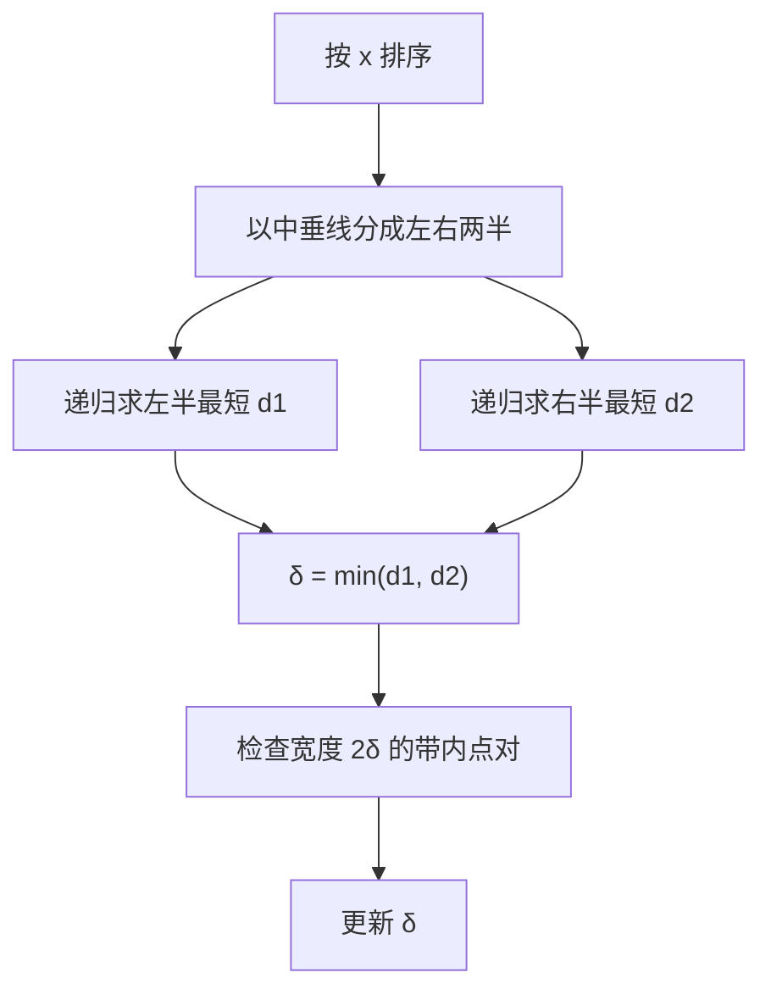
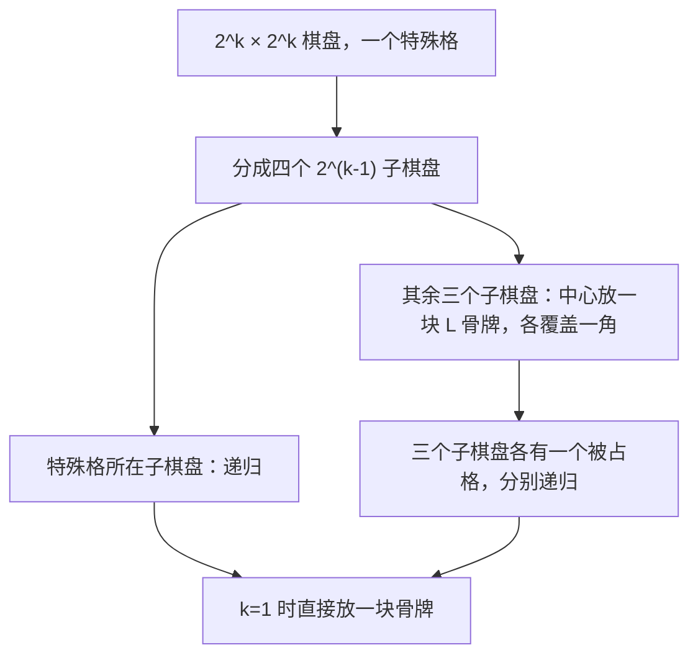

# 4.5 最近点对、棋盘覆盖与分治总结

## 4.5.1 最近点对问题

问题：给定平面上的 $n$ 个点，找出一对点，使它们之间的距离最小。

蛮力法要计算 $\binom{n}{2}$ 个点对，$O(n^2)$。分治法的目标是把合并步骤压到 $O(n)$，从而得到 $O(n\log n)$。

### 分治思路

1. 把所有点按 $x$ 坐标排序；
2. 用一条垂直线 $x=x_m$ 把点集分成左右两半，各约 $n/2$ 个点；
3. 递归求出左半部分的最短距离 $d_1$ 和右半部分的最短距离 $d_2$，令 $\delta=\min(d_1,d_2)$；
4. **合并**：还需要检查“一个点在左、一个点在右”的跨界线对。只需考虑距离中线不超过 $\delta$ 的点，构成一条宽度为 $2\delta$ 的**带（strip）**。



### 合并步骤的关键：带内只需比较常数个点

把带内的点按 $y$ 坐标排序。对带内每个点 $p$，只需检查它**后面**的几个点 $q$：一旦 $q.y-p.y\ge\delta$，就可以停止。

为什么只需要检查常数个？把带内区域划分成若干个 $\delta/2\times\delta/2$ 的小方格。每个小方格内最多有一个点（否则这两点距离小于 $\delta$，与 $\delta$ 是最短距离矛盾）。而与 $p$ 的 $y$ 距离小于 $\delta$ 的范围，最多覆盖 $2\times4=8$ 个小方格，除去 $p$ 自己，最多再检查 **7 个点**。

因此合并只需 $O(n)$ 时间：

$$T(n)=2T\left(\frac{n}{2}\right)+O(n)\quad\Longrightarrow\quad T(n)=O(n\log n)$$

::: warning 排序的代价
若每次递归都对带内点重新按 $y$ 排序，合并代价变成 $O(n\log n)$，总复杂度退化为 $O(n\log^2 n)$。正确做法是：递归时**同时返回按 $y$ 排好序的点列**，合并时像归并排序一样在线性时间内归并两个有序点列。这样总复杂度才是 $O(n\log n)$。
:::

### 参考实现

```java
double closestPair(Point[] px, int l, int r) {
    if (r - l <= 3) return bruteForce(px, l, r);
    int m = (l + r) / 2;
    double midX = px[m].x;
    double d = Math.min(closestPair(px, l, m), closestPair(px, m + 1, r));
    // 收集带内点（实际实现中应保持按 y 有序）
    List<Point> strip = new ArrayList<>();
    for (int i = l; i <= r; i++)
        if (Math.abs(px[i].x - midX) < d) strip.add(px[i]);
    strip.sort(Comparator.comparingDouble(p -> p.y));
    for (int i = 0; i < strip.size(); i++)
        for (int j = i + 1; j < strip.size() && strip.get(j).y - strip.get(i).y < d; j++)
            d = Math.min(d, dist(strip.get(i), strip.get(j)));
    return d;
}
```

::: tip 从 $O(n^2)$ 到 $O(n\log n)$ 的关键
蛮力法的问题在于“每个点都要和其余所有点比”。分治法利用了一个几何事实：**若已知左右两半的最短距离为 $\delta$，那么跨界的更短点对只可能出现在一条窄带里，而窄带内每个点附近最多只有常数个候选**。这正是“用几何约束剪枝”的典范。
:::

## 4.5.2 棋盘覆盖问题

问题：在一个 $2^k\times2^k$ 的棋盘中，恰有一个方格与其他方格不同，称为**特殊方格**。用 4 种不同形态的 L 型骨牌覆盖除特殊方格外的所有方格，骨牌不得重叠。求一种覆盖方案。

### 关键观察

- 棋盘总格数为 $4^k$，除去特殊方格剩 $4^k-1$ 个，每块 L 型骨牌占 $3$ 格，因此骨牌数恰为

$$\frac{4^k-1}{3}$$

- 当 $k=1$ 时，$2\times2$ 棋盘去掉一格，剩下的 3 格正好是一块 L 型骨牌，直接覆盖。

### 分治策略

把 $2^k\times2^k$ 棋盘分成四个 $2^{k-1}\times2^{k-1}$ 的子棋盘。特殊方格必在其中一个子棋盘内，另外三个子棋盘**没有特殊方格**。

为了让这三个子棋盘也能递归，我们在棋盘**正中心**放置一块 L 型骨牌，让它恰好覆盖这三个子棋盘各自靠近中心的一个角。这样，每个子棋盘都“有”了一个被占用的方格，可以独立递归。



### 算法

```plaintext
cover(tr, tc, dr, dc, size)
// tr, tc：当前棋盘左上角行列；dr, dc：特殊方格位置；size：边长
if size = 1 return
t ← ++tile                  // 当前骨牌编号
s ← size / 2
// 左上子棋盘
if dr < tr+s and dc < tc+s
    cover(tr, tc, dr, dc, s)
else
    board[tr+s-1][tc+s-1] ← t
    cover(tr, tc, tr+s-1, tc+s-1, s)
// 右上子棋盘
if dr < tr+s and dc ≥ tc+s
    cover(tr, tc+s, dr, dc, s)
else
    board[tr+s-1][tc+s] ← t
    cover(tr, tc+s, tr+s-1, tc+s, s)
// 左下子棋盘
if dr ≥ tr+s and dc < tc+s
    cover(tr+s, tc, dr, dc, s)
else
    board[tr+s][tc+s-1] ← t
    cover(tr+s, tc, tr+s, tc+s-1, s)
// 右下子棋盘
if dr ≥ tr+s and dc ≥ tc+s
    cover(tr+s, tc+s, dr, dc, s)
else
    board[tr+s][tc+s] ← t
    cover(tr+s, tc+s, tr+s, tc+s, s)
```

### 复杂度

每层把问题分成 4 个规模减半的子问题，中心放置骨牌是 $O(1)$：

$$T(k)=4T(k-1)+O(1),\qquad T(0)=O(1)$$

解得 $T(k)=O(4^k)$，恰好等于棋盘格数，也是输出方案所需的下界。

::: info 为什么这个分治是“满”的？
棋盘覆盖必须给每个非特殊格填上骨牌编号，输出本身就有 $\Theta(4^k)$ 个格子。因此 $O(4^k)$ 已经是最优，不存在“更快”的算法。这与排序不同：排序的输出是 $n$ 个数，但可以通过比较结构把时间降到 $O(n\log n)$。
:::

## 4.5.3 分治法总结

### 典型算法的递推与复杂度

| 问题 | 递推式 | 复杂度 | 关键技巧 |
| :--- | :--- | :--- | :--- |
| 二分查找 | $T(n)=T(n/2)+O(1)$ | $O(\log n)$ | 有序性 |
| 全排列 | $T(n)=nT(n-1)+O(n)$ | $O(n!)$ | 交换 + 恢复现场 |
| 整数划分 | $T(n)=T(n-1)+T(n-m)+\dots$ | 指数（记忆化后 $O(n^2)$） | 增加自变量 |
| 大整数乘法 | $T(n)=3T(n/2)+O(n)$ | $O(n^{1.585})$ | 代数恒等式减少乘法 |
| Strassen | $T(n)=7T(n/2)+O(n^2)$ | $O(n^{2.807})$ | 7 次分块乘法 |
| 归并排序 | $T(n)=2T(n/2)+O(n)$ | $O(n\log n)$ | 线性合并 |
| 快速排序 | 平均 $2T(n/2)+O(n)$ | 平均 $O(n\log n)$ | 划分 |
| 线性选择 | $T(n/5)+T(7n/10)+O(n)$ | $O(n)$ | 中位数的中位数 |
| 最近点对 | $T(n)=2T(n/2)+O(n)$ | $O(n\log n)$ | 带宽 + 常数邻居 |
| 棋盘覆盖 | $T(k)=4T(k-1)+O(1)$ | $O(4^k)$ | 中心补骨牌 |

### 设计分治算法的检查清单

1. **能否分解**：问题能否拆成若干个同类型的子问题？
2. **规模是否均衡**：子问题规模是否大致相同？不均衡会导致递推树退化为链。
3. **合并是否便宜**：合并代价能否控制在 $O(n)$ 或 $O(n\log n)$？若合并是 $O(n^2)$，分治就白分了。
4. **子问题是否独立**：若重叠，改用动态规划。
5. **递归基是否明确**：规模多小的时候直接求解？
6. **能否预处理**：排序、前缀和、坐标压缩，往往能把每层的 $O(n\log n)$ 降到 $O(n)$。

### 开放性讨论

**分治应该把问题分成多少个子问题？**

- 子问题越多，每层并行度越高，但子问题规模缩小得越慢，递归树可能更“宽”；
- 子问题越少，递归深度越大，但合并次数少；
- 常见选择是 $2$ 个（对半），因为它让规模按 $1/2$ 指数缩小，深度为 $\log n$；
- 矩阵乘法用 $2\times2$ 分块得到 $8$ 个子问题，再通过代数变换降到 $7$ 个，说明**“减少子问题个数”比“增加子问题个数”更能降低指数**。

**分治一定提高效率吗？**

不一定。求 $n$ 个数之和，分治与顺序累加都是 $O(n)$，但分治多了递归开销；求 $n$ 的阶乘，分治也没有优势。分治的收益来自：

- 子问题规模显著缩小（如排序、查找）；
- 合并代价低于朴素做法（如最近点对）；
- 子问题可以并行（如大整数乘法、矩阵乘法）。

**分治降低复杂度的本质措施**

| 措施 | 例子 | 效果 |
| :--- | :--- | :--- |
| 代数变换，减少子问题个数 | Karatsuba、Strassen | 指数从 $\log_2 4$ 降到 $\log_2 3$ |
| 利用中间结果 | 归并的已有序段、快排的划分 | 合并 $O(n)$ |
| 数据预处理 | 最近点对按 $x/y$ 排序 | 避免每层重复排序 |
| 剪枝/几何约束 | 带宽内只查常数个邻居 | 合并从 $O(n^2)$ 降到 $O(n)$ |

> 分治不是“为了递归而递归”，而是**用结构换效率**：把问题拆成可以独立处理、又能低成本合并的部分。找到那个“既能拆、又好合”的切分点，才是分治设计的核心。
