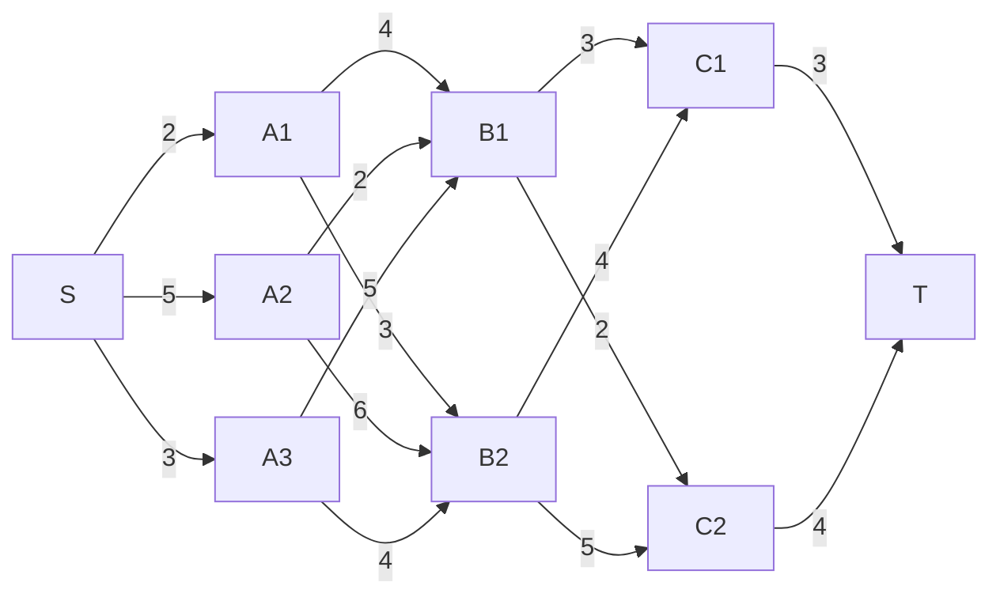

# 5.1 动态规划的基本思想与求解步骤

## 5.1.1 从“重复计算”说起

动态规划与分治法类似，都是把求解的问题分成许多阶段或多个子问题，然后按顺序求解。**最后一个阶段或子问题的解，就是初始问题的解**。

但二者有一个关键区别：

- 分治法分解出的子问题**互相独立**，可以分别求解；
- 动态规划分解出的子问题**往往不是互相独立的**，不同子问题的数目常常只有多项式级，但分治法会把它们重复计算许多次，导致时间复杂度飙升。

动态规划的基本思想是：**保留已解决的子问题的解，在需要时直接查表，从而避免大量重复计算**。

回忆斐波那契数列：$F(n)=F(n-1)+F(n-2)$。朴素递归会把 $F(3)$、$F(4)$ 反复计算，时间复杂度 $\Theta(\varphi^n)$；若把每个 $F(k)$ 只算一次并存入数组，复杂度立刻降到 $O(n)$。这就是动态规划最朴素的形式。

## 5.1.2 适用条件

一个问题能用动态规划求解，通常需要满足三个性质：

### （1）最优子结构

**问题的最优解包含其子问题的最优解**。也就是说，若原问题的最优决策把问题分成了若干子问题，那么这些子问题的解也必须是各自最优的。

> 若不然，把子问题的非最优解换成最优解，就能得到原问题更优的解，与原解最优矛盾。

### （2）无后效性

**某阶段的状态一旦确定，就不受之后决策的影响**。当前状态包含了此前决策的全部必要信息，未来的决策只依赖于当前状态，而不关心“这个状态是怎么来的”。

> 无后效性是状态设计是否正确的试金石。如果发现“未来还要看以前走过的路”，说明状态信息不够，需要把历史信息压缩进状态（增加维度）。

### （3）重叠子问题

**不同的子问题会被重复求解**。这正是动态规划相对于分治法的优势所在：把结果存表，避免重复。

::: tip 三个性质的关系
- **最优子结构**决定“能不能用 DP”；
- **无后效性**决定“状态怎么设计”；
- **重叠子问题**决定“用 DP 划不划算”。

若子问题不重叠，分治即可，没必要开表；若最优子结构不成立，DP 得到的“最优值”可能是错的。
:::

## 5.1.3 多阶段决策：一个直观例子

考虑下面这个多段图最短路问题：从 $S$ 出发到 $T$，每条边有非负权值，求最短路径。

按阶段从左到右计算“从 $S$ 到每个结点的最短距离”：

| 阶段 | 结点 | 最短距离 | 决策（从哪来） |
| :--- | :--- | ---: | :--- |
| 1 | $A_1$ | 2 | $S$ |
| 1 | $A_2$ | 5 | $S$ |
| 1 | $A_3$ | 3 | $S$ |
| 2 | $B_1$ | $\min(2+4,5+2,3+5)=6$ | $A_1$ |
| 2 | $B_2$ | $\min(2+3,5+6,3+4)=5$ | $A_1$ |
| 3 | $C_1$ | $\min(6+3,5+4)=9$ | $B_1$ |
| 3 | $C_2$ | $\min(6+2,5+5)=8$ | $B_1$ |
| 4 | $T$ | $\min(9+3,8+4)=12$ | $C_1$ |

最优路径为 $S\to A_1\to B_1\to C_1\to T$，长度 $12$。

设 $dp[v]$ 表示从 $S$ 到 $v$ 的最短距离，则

$$dp[v]=\min_{(u,v)\in E}\bigl\{dp[u]+w(u,v)\bigr\},\qquad dp[S]=0$$

这个式子就是**状态转移方程**。它体现了无后效性：$dp[v]$ 只依赖于前驱结点的 $dp$ 值，与“怎么走到 $u$ 的”无关。

::: info 状态不够怎么办？
若问题要求“路径长度模 $10$ 最小”，仅记录 $dp[v]$ 就不够了，因为不同的余数会影响后续转移。此时应把状态扩展为 $dp[v][r]$：到达 $v$、路径长度模 $10$ 余 $r$ 时的最小长度。**状态维度是根据“未来需要什么信息”加出来的**，这是动态规划设计中最考验功力的一步。
:::

## 5.1.4 求解的四个步骤

1. **找出最优解的性质，并刻画其结构特征**。分析原问题的最优解由哪些子问题的解组成。
2. **递归地定义最优值**。写出状态与状态转移方程，明确边界条件。
3. **以自底向上的方式计算出最优值**。按依赖关系确定计算顺序，填表。
4. **根据计算最优值时得到的信息，构造最优解**。通常需要另开一个“决策表”，记录每个状态选择了哪个决策，最后回溯。

::: warning 第 4 步常被忽略
很多同学只会求“最优值”，不会输出“最优方案”。考试若要求“给出最优解”，必须保留决策信息（如矩阵连乘的断点 $s[i][j]$、LCS 的方向 $b[i][j]$、背包的选取标记），否则只能拿到一半分。
:::

## 5.1.5 自底向上 vs 自顶向下

| 方式 | 做法 | 优点 | 缺点 |
| :--- | :--- | :--- | :--- |
| 自底向上（递推） | 按规模从小到大填表 | 无递归开销，便于空间优化 | 需要先想清楚计算顺序 |
| 自顶向下（记忆化） | 递归 + 查表 | 只计算真正用到的状态 | 有递归栈开销，常数较大 |

两者本质相同，都是“每个状态只算一次”。若状态空间是稀疏的（很多状态用不到），记忆化更合适；若状态空间稠密且依赖关系清晰，递推更高效。

## 5.1.6 常见模型

| 模型 | 状态形式 | 典型问题 |
| :--- | :--- | :--- |
| 线性 DP | $dp[i]$ 表示前 $i$ 个元素 | 最大子段和、最长递增子序列 |
| 区间 DP | $dp[i][j]$ 表示区间 $[i,j]$ | 矩阵连乘、最优三角剖分、最优 BST |
| 背包 DP | $dp[i][j]$ 表示前 $i$ 件物品、容量 $j$ | 0-1 背包、完全背包、多重背包 |
| 双序列 DP | $dp[i][j]$ 表示两个前缀 | LCS、编辑距离、序列匹配 |
| 树形 DP | $dp[u][\cdot]$ 表示以 $u$ 为根的子树 | 树上最大独立集、树的直径 |
| 状压 DP | 用二进制表示集合 | TSP、棋盘覆盖计数 |
| 数位 DP | $dp[pos][state]$ | 统计满足条件的数字个数 |

## 5.1.7 动态规划与分治、贪心的对比

| 维度 | 分治 | 动态规划 | 贪心 |
| :--- | :--- | :--- | :--- |
| 子问题关系 | 独立 | 重叠 | 每次只做一个决策 |
| 求解方向 | 递归 | 自底向上/记忆化 | 自顶向下 |
| 是否回退 | 否 | 否（但比较所有决策） | 否 |
| 最优性 | 依赖子问题最优 | 最优子结构 + 无后效性 | 贪心选择性质 |
| 典型问题 | 归并排序 | 矩阵连乘、背包 | 活动安排、Huffman |

::: tip 一句话区分
- 分治：**分开算，再合并**；
- 动态规划：**不重复算，查表**；
- 贪心：**只算眼前最好的一步，不回头**。
:::
