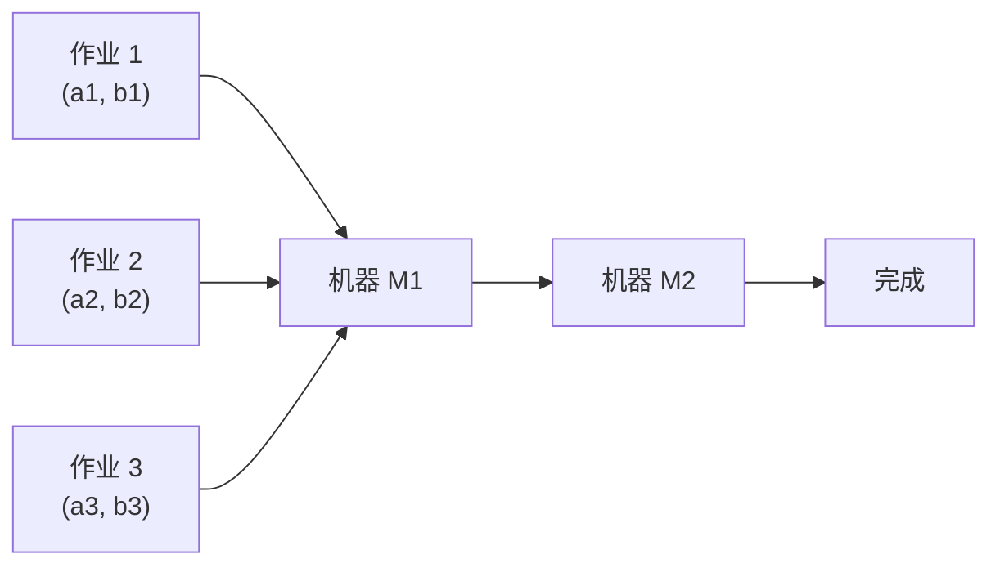

# 5.6 最优二叉搜索树与流水作业调度

## 5.6.1 最优二叉搜索树问题

### 背景：二叉搜索树

二叉排序树（BST）满足：

1. 若左子树不空，则左子树上所有结点的值均小于根结点的值；
2. 若右子树不空，则右子树上所有结点的值均大于根结点的值；
3. 左、右子树也分别为二叉排序树。

在随机情况下，二叉搜索树的平均查找长度与 $\log n$ 同数量级。但若各元素的查找概率不同，树的形状会显著影响平均查找长度。

### 问题描述

设数据集 $S=\{x_1,x_2,\dots,x_n\}$，$x_1<x_2<\cdots<x_n$。查找可能成功（命中某个 $x_i$），也可能失败（落在某个开区间 $(x_i,x_{i+1})$ 中）。设：

- $b_i$ 为查找 $x_i$ 的概率；
- $a_i$ 为查找落在区间 $(x_i,x_{i+1})$ 的概率，其中 $a_0$ 表示 $x<x_1$，$a_n$ 表示 $x>x_n$。

则

$$\sum_{i=0}^{n}a_i+\sum_{i=1}^{n}b_i=1$$

设根结点深度为 $0$，则一次成功查找的比较次数为 $\text{depth}(x_i)+1$，一次失败查找的比较次数为 $\text{depth}(d_i)+1$（$d_i$ 为叶结点）。平均查找长度为

$$E(T)=\sum_{i=1}^{n}\bigl(\text{depth}(x_i)+1\bigr)b_i+\sum_{i=0}^{n}\bigl(\text{depth}(d_i)+1\bigr)a_i$$

目标：构造一棵二叉搜索树，使 $E(T)$ 最小。

### 一个例子

设 $S=\{a,b,c,d,e\}$，概率分布为

$$P=(a_0,b_1,a_1,b_2,a_2,b_3,a_3,b_4,a_4,b_5,a_5)=\frac{(4,10,2,30,2,10,5,20,6,10,1)}{100}$$

即 $b=(0.10,0.30,0.10,0.20,0.10)$，$a=(0.04,0.02,0.02,0.05,0.06,0.01)$。

一棵可能的树（以 $c$ 为根）的平均查找长度为

$$0.3\times1+(0.1+0.2)\times2+(0.1+0.1)\times3+(0.04+0.02)\times2+(0.02+0.05+0.06+0.01)\times3=2.04$$

这棵树是否最好？需要系统地搜索。

### 最优子结构

设 $s[i..j]=\langle x_i,\dots,x_j\rangle$ 是以 $i,j$ 为边界的子数据集，对应的概率分布为

$$p[i..j]=\langle a_{i-1},b_i,a_i,b_{i+1},\dots,b_j,a_j\rangle$$

若以 $x_k$（$i\le k\le j$）为根，则原问题划分为两个子问题：

- 左子树：$s[i..k-1]$，$p[i..k-1]$；
- 右子树：$s[k+1..j]$，$p[k+1..j]$。

::: details 最优子结构证明
若左子树不是 $s[i..k-1]$ 的最优 BST，则把它替换为更优的左子树，整棵树的平均查找长度会减少（右子树同理），与“原树最优”矛盾。因此左右子树都必须是最优的。
:::

### 递推方程

设 $m[i][j]$ 为相对于 $s[i..j]$ 和 $p[i..j]$ 的最优 BST 的平均比较次数，$w[i][j]$ 为 $p[i..j]$ 中所有概率之和：

$$w[i][j]=a_{i-1}+\sum_{k=i}^{j}\bigl(b_k+a_k\bigr)$$

则

$$m[i][j]=\min_{i\le k\le j}\Bigl\{m[i][k-1]+m[k+1][j]\Bigr\}+w[i][j]$$

边界：空树的代价为 $0$，即 $m[i][i-1]=0$。

::: details 为什么加的是 $w[i][j]$？
当以 $x_k$ 为根时，左、右子树中所有结点的深度都比它们在原子树中增加了 $1$。因此，除了左、右子树本身的代价外，还要为 $p[i..j]$ 中的每一个概率（包括成功与失败）多付一次比较。多付的总量恰好是 $w[i][j]$。
:::

### 计算

```java
void optimalBST(int n, double[] a, double[] b, double[][] m, int[][] s, double[][] w) {
    for (int i = 0; i <= n; i++) {
        w[i + 1][i] = a[i];
        m[i + 1][i] = 0;
    }
    for (int r = 0; r < n; r++) {                 // 区间长度减 1
        for (int i = 1; i <= n - r; i++) {
            int j = i + r;
            w[i][j] = w[i][j - 1] + a[j] + b[j];
            m[i][j] = m[i + 1][j];
            s[i][j] = i;
            for (int k = i + 1; k <= j; k++) {
                double t = m[i][k - 1] + m[k + 1][j];
                if (t < m[i][j]) { m[i][j] = t; s[i][j] = k; }
            }
            m[i][j] += w[i][j];
        }
    }
}
```

- 时间 $O(n^3)$，空间 $O(n^2)$；
- $s[i][j]$ 保存最优子树的根，可在 $O(n)$ 时间内构造整棵树。

### 算例

对上面的概率分布，逐步计算（数值为概率，最后乘以 $100$ 即百分数）：

| 区间长度 | 结果 |
| :--- | :--- |
| $r=0$ | $m[1][1]=0.16,\ m[2][2]=0.34,\ m[3][3]=0.17,\ m[4][4]=0.31,\ m[5][5]=0.17$ |
| $r=1$ | $m[1][2]=0.64,\ m[2][3]=0.66,\ m[3][4]=0.60,\ m[4][5]=0.59$ |
| $r=2$ | $m[1][3]=0.96,\ m[2][4]=1.35,\ m[3][5]=0.88$ |
| $r=3$ | $m[1][4]=1.65,\ m[2][5]=1.69$ |
| $r=4$ | $m[1][5]=2.04$ |

最终 $m[1][5]=2.04$，与前面那棵树相同，说明它已经是最优的。由 $s[1][5]=2$ 知根为 $b$；继续查表可构造整棵树。

::: tip 与矩阵连乘的同构
最优 BST 的递推式

$$m[i][j]=\min_{i\le k\le j}\{m[i][k-1]+m[k+1][j]\}+w[i][j]$$

与矩阵连乘

$$m[i][j]=\min_{i\le k<j}\{m[i][k]+m[k+1][j]\}+p_{i-1}p_kp_j$$

结构完全一致：都是“枚举断点、左右子区间、加上合并代价”。区别只在于下标偏移与合并代价的定义。

:::

### 四边形不等式优化

若权重满足四边形不等式，最优断点满足单调性：

$$s[i][j-1]\le s[i][j]\le s[i+1][j]$$

于是枚举 $k$ 的范围从 $O(n)$ 缩小到均摊 $O(1)$，总复杂度降到 $O(n^2)$。这就是 Knuth 优化。考试中若题目特意给出单调性条件，应使用该优化。

## 5.6.2 流水作业调度问题

### 问题描述

$n$ 个作业 $\{1,2,\dots,n\}$ 要在由两台机器 $M_1$、$M_2$ 组成的流水线上加工。每个作业都必须先在 $M_1$ 上加工，再在 $M_2$ 上加工；作业 $i$ 在 $M_1$、$M_2$ 上的加工时间分别为 $a_i$、$b_i$。求最优加工顺序，使从第一个作业在 $M_1$ 上开始，到最后一个作业在 $M_2$ 上完成的总时间最少。



### 最优子结构

设全部作业集合为 $N=\{1,2,\dots,n\}$，$S\subseteq N$。一般情况下，$M_1$ 开始加工 $S$ 中的作业时，$M_2$ 还在加工其他作业，要等时间 $t$ 后才可用。记这种情况下完成 $S$ 中所有作业所需的最短时间为 $T(S,t)$。

原问题的最优值为 $T(N,0)$。

设最优调度中第一个作业为 $i$，则

$$T(S,t)=a_i+T\bigl(S-\{i\},\ b_i+\max\{t-a_i,0\}\bigr)$$

- $a_i$ 是作业 $i$ 在 $M_1$ 上的加工时间；
- 作业 $i$ 在 $M_2$ 上开始的时间是 $\max\{t,a_i\}$，完成后 $M_2$ 的可用时间为 $\max\{t,a_i\}+b_i$；
- 对剩余作业而言，$M_2$ 的“等待时间”就是 $b_i+\max\{t-a_i,0\}$。

于是

$$T(N,0)=\min_{1\le i\le n}\Bigl\{a_i+T\bigl(N-\{i\},b_i\bigr)\Bigr\}$$

这个递推的状态是指数级的（子集 $S$ 与实数 $t$），直接 DP 不可行。但它的结构引出了一个更简单的贪心规则。

### Johnson 不等式

设最优调度中前两个作业为 $i,j$。可以推出

$$T(S,t)=a_i+a_j+T\bigl(S-\{i,j\},t_{ij}\bigr)$$

其中

$$t_{ij}=b_i+b_j+\max\{t-a_i-a_j,\ a_j-a_i-b_i,\ 0\}$$

交换 $i,j$ 得到另一个调度，其时间为 $T'(S,t)=a_i+a_j+T(S-\{i,j\},t_{ji})$。若

$$\min\{b_i,a_j\}\ge\min\{b_j,a_i\}$$

则 $t_{ij}\le t_{ji}$，从而 $T(S,t)\le T'(S,t)$。这个不等式称为 **Johnson 不等式**。

进一步可以证明：**调度满足 Johnson 法则，当且仅当对任意 $i<j$ 有**

$$\min\{b_{\pi(i)},a_{\pi(j)}\}\ge\min\{b_{\pi(j)},a_{\pi(i)}\}$$

且所有满足 Johnson 法则的调度都是最优调度。

### Johnson 算法

1. 令

$$N_1=\{i\mid a_i<b_i\},\qquad N_2=\{i\mid a_i\ge b_i\}$$

2. 将 $N_1$ 中的作业按 $a_i$ **非减序**排序；
3. 将 $N_2$ 中的作业按 $b_i$ **非增序**排序；
4. 将 $N_1$ 接在 $N_2$ 前面，即得最优调度。

```java
List<Integer> johnson(int[] a, int[] b, int n) {
    List<Integer> n1 = new ArrayList<>(), n2 = new ArrayList<>();
    for (int i = 0; i < n; i++) {
        if (a[i] < b[i]) n1.add(i);
        else n2.add(i);
    }
    n1.sort(Comparator.comparingInt(i -> a[i]));
    n2.sort((i, j) -> b[j] - b[i]);
    n1.addAll(n2);
    return n1;
}
```

复杂度主要花在排序上，$O(n\log n)$，空间 $O(n)$。

### 一个例子

三个作业，加工时间为

| 作业 | $a_i$（M1） | $b_i$（M2） |
| :--- | ---: | ---: |
| 1 | 2 | 1 |
| 2 | 3 | 1 |
| 3 | 2 | 3 |

- $N_1=\{3\}$（$2<3$），按 $a$ 升序：$3$；
- $N_2=\{1,2\}$（$a\ge b$），按 $b$ 降序：$1,2$（$b$ 都为 $1$，顺序任意）。

最优顺序为 $3,1,2$。计算时间线：

| 作业 | M1 加工区间 | M2 加工区间 |
| :--- | :--- | :--- |
| 3 | $[0,2]$ | $[2,5]$ |
| 1 | $[2,4]$ | $[5,6]$ |
| 2 | $[4,7]$ | $[7,8]$ |

总完成时间 $8$。若按 $1,2,3$ 加工，则总完成时间为 $10$。

::: tip 流水作业调度的两条路线
本问题在动态规划章节出现，是因为它的最优子结构非常漂亮；但最终的高效算法是 **Johnson 贪心**，而不是 DP。这提醒我们：**DP 能刻画问题结构，但未必是最终实现**。考试中若问“设计算法”，应直接给出 Johnson 算法并证明其正确性；若问“分析最优子结构”，则写出 $T(S,t)$ 的递推。
:::

## 5.6.3 两个问题的对比

| 维度 | 最优二叉搜索树 | 流水作业调度 |
| :--- | :--- | :--- |
| 解的形式 | 一棵 BST | 一个作业排列 |
| 状态 | 区间 $[i,j]$ | 子集 $S$ 与等待时间 $t$ |
| 递推类型 | 区间划分 | 排列决策 |
| 时间复杂度 | $O(n^3)$（可优化到 $O(n^2)$） | 朴素 DP 指数级 |
| 最终算法 | 区间 DP | Johnson 贪心 $O(n\log n)$ |
| 核心性质 | 最优子结构 | 最优子结构 + 交换论证 |
