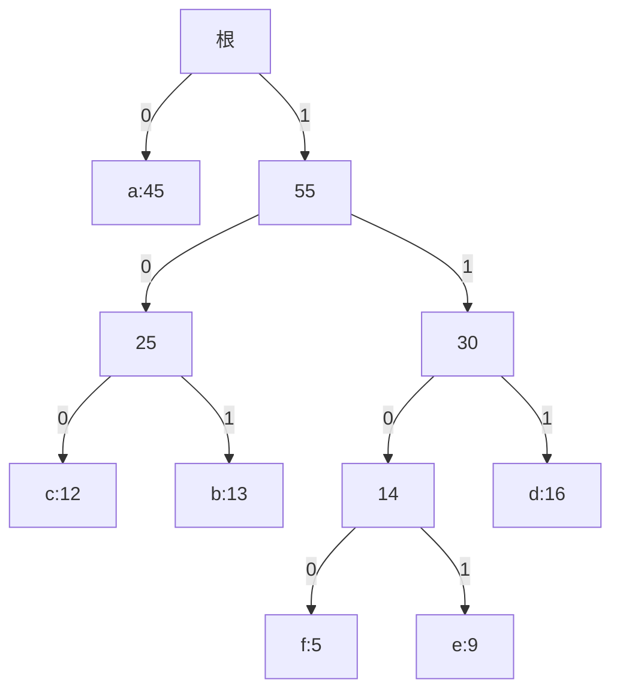

# 6.3 哈夫曼编码

## 6.3.1 从定长编码到变长编码

计算机中字符通常用定长编码表示，例如 ASCII 用 $8$ 位表示一个字符。若一段文本中只有 6 种字符，定长编码仍需 $3$ 位/字符；但各字符出现频率往往差别很大，**让高频字符用短码、低频字符用长码**，就能显著压缩总长度。

例如，一段文本中 6 个字符的出现频率为：

| 字符 | a | b | c | d | e | f |
| :--- | ---: | ---: | ---: | ---: | ---: | ---: |
| 频率（千次） | 45 | 13 | 12 | 16 | 9 | 5 |

定长编码需要 $3$ 位/字符，总位数 $3\times100=300$（千位）。若采用变长编码，有望降到 $224$（千位）。

### 前缀码

变长编码必须保证**唯一可解码**。最常用的约束是**前缀码（prefix code）**：

> 任何一个字符的编码都不是另一个字符编码的前缀。

例如 $\{0,10,110,111\}$ 是前缀码；$\{0,01,011\}$ 不是，因为 `0` 是 `01` 的前缀。

前缀码可以用一棵**二叉树**表示：

- 每个叶子对应一个字符；
- 从根到叶子的路径上，向左走记 $0$，向右走记 $1$，得到该字符的编码；
- 没有任何字符编码是另一个的前缀，等价于“所有字符都在叶子上”。



对应的编码为：

| 字符 | 编码 | 长度 |
| :--- | :--- | ---: |
| a | 0 | 1 |
| c | 100 | 3 |
| b | 101 | 3 |
| f | 1100 | 4 |
| e | 1101 | 4 |
| d | 111 | 3 |

## 6.3.2 带权路径长度

设字符 $i$ 的频率为 $w_i$，编码长度为 $l_i$，则编码总长度为

$$\text{WPL}=\sum_{i=1}^{n}w_i l_i$$

在二叉树中，$l_i$ 就是叶子 $i$ 的深度（根深度为 $0$）。因此，**哈夫曼编码问题等价于：构造一棵二叉树，使所有叶子的带权路径长度之和最小**。

上例的 WPL 为

$$45\times1+12\times3+13\times3+5\times4+9\times4+16\times3=224$$

相比定长编码的 $300$，压缩了约 $25\%$。

## 6.3.3 哈夫曼算法

### 贪心策略

**每次从当前森林中选出两棵根权值最小的树，合并成一棵新树，新根的权值为两棵子树权值之和**。重复 $n-1$ 次，直到只剩一棵树。

```text
Huffman(C)
n ← |C|
Q ← 以频率为键的最小优先队列，初始包含所有字符
for i ← 1 to n-1
    分配一个新结点 z
    x ← Q.extractMin()
    y ← Q.extractMin()
    z.left ← x
    z.right ← y
    z.freq ← x.freq + y.freq
    Q.insert(z)
return Q.extractMin()
```

```java
class Node {
    char ch;
    int freq;
    Node left, right;
}

Node huffman(char[] chars, int[] freq) {
    PriorityQueue<Node> pq = new PriorityQueue<>(
        (x, y) -> x.freq - y.freq);
    for (int i = 0; i < chars.length; i++) {
        Node node = new Node();
        node.ch = chars[i];
        node.freq = freq[i];
        pq.add(node);
    }
    while (pq.size() > 1) {
        Node x = pq.poll(), y = pq.poll();
        Node z = new Node();
        z.freq = x.freq + y.freq;
        z.left = x;
        z.right = y;
        pq.add(z);
    }
    return pq.poll();
}
```

- 每个字符入队一次、合并产生 $n-1$ 个内部结点，每次堆操作 $O(\log n)$；
- 总时间 $O(n\log n)$，空间 $O(n)$。

### 构造编码

从根出发做一次 DFS，向左记 `0`、向右记 `1`，到达叶子时输出路径：

```java
void generateCodes(Node root, String code, Map<Character, String> map) {
    if (root == null) return;
    if (root.left == null && root.right == null) {
        map.put(root.ch, code);
        return;
    }
    generateCodes(root.left, code + "0", map);
    generateCodes(root.right, code + "1", map);
}
```

## 6.3.4 正确性证明

哈夫曼算法的正确性由两个引理组成。

### 引理 1（贪心选择性质）

**存在一棵最优前缀码树，其中频率最小的两个字符是兄弟，且深度最大。**

::: details 证明（交换论证）
设 $x,y$ 是频率最小的两个字符，$a,b$ 是树中深度最大的一对兄弟叶子。不妨设 $f(x)\le f(y)$，$f(a)\le f(b)$，则 $f(x)\le f(a)$，$f(y)\le f(b)$。

把 $x$ 与 $a$ 交换，$y$ 与 $b$ 交换。交换后 $x,y$ 成为深度最大的兄弟。总代价的变化为

$$\Delta=f(x)d(a)+f(a)d(x)-f(x)d(x)-f(a)d(a)=(f(a)-f(x))(d(a)-d(x))$$

由于 $f(a)\ge f(x)$ 且 $d(a)\ge d(x)$，故 $\Delta\ge0$，即交换后代价不增。因此存在一棵最优树，其中 $x,y$ 是深度最大的兄弟。
:::

### 引理 2（最优子结构）

**把频率最小的两个字符 $x,y$ 合并成一个频率为 $f(x)+f(y)$ 的新字符 $z$，则原问题的最优树可以由新问题的最优树把 $z$ 展开为 $x,y$ 得到。**

::: details 证明
设 $T$ 是包含 $x,y$ 为兄弟的最优树，把 $x,y$ 收缩成叶子 $z$ 得到 $T'$。则

$$\text{WPL}(T)=\text{WPL}(T')+f(x)+f(y)$$

若 $T'$ 不是新问题的最优树，设 $T''$ 更优，则把 $z$ 展开为 $x,y$ 得到的树 $T'''$ 满足

$$\text{WPL}(T''')=\text{WPL}(T'')+f(x)+f(y)<\text{WPL}(T')+f(x)+f(y)=\text{WPL}(T)$$

与 $T$ 最优矛盾。故 $T'$ 最优。
:::

由引理 1 与引理 2，每一步合并最小频率的两个结点都不会破坏最优性，归纳可得哈夫曼算法正确。

::: warning 哈夫曼树不唯一
当有多个相同频率的结点时，合并顺序可能不同，得到的树和编码也可能不同，但**最小带权路径长度是唯一的**。考试中若要求编码，按“每次取最小、相同频率任取”的规则写出一种即可。
:::

## 6.3.5 一个完整的例子

对频率 $45,13,12,16,9,5$ 构造哈夫曼树：

| 步骤 | 操作 | 森林（按频率） |
| ---: | :--- | :--- |
| 1 | 合并 5,9 | $12,13,14,16,45$ |
| 2 | 合并 12,13 | $14,16,25,45$ |
| 3 | 合并 14,16 | $25,30,45$ |
| 4 | 合并 25,30 | $45,55$ |
| 5 | 合并 45,55 | $100$ |

编码与长度：

| 字符 | 频率 | 编码 | 长度 | 贡献 |
| :--- | ---: | :--- | ---: | ---: |
| a | 45 | 0 | 1 | 45 |
| c | 12 | 100 | 3 | 36 |
| b | 13 | 101 | 3 | 39 |
| f | 5 | 1100 | 4 | 20 |
| e | 9 | 1101 | 4 | 36 |
| d | 16 | 111 | 3 | 48 |
| **合计** | 100 | | | **224** |

若用定长编码，需要 $\lceil\log_2 6\rceil=3$ 位/字符，总长度 $300$。哈夫曼编码节省了 $76$（约 $25\%$）。

## 6.3.6 哈夫曼编码的性质与应用

| 性质 | 说明 |
| :--- | :--- |
| 最优性 | 在所有前缀码中，哈夫曼编码的 WPL 最小 |
| 非唯一性 | 相同频率的结点交换不影响 WPL |
| 自适应性 | 编码依赖字符频率，不同文本得到不同编码 |
| 需传输码表 | 解码需要知道编码表，码表本身占用空间 |
| 不适用于所有数据 | 频率分布均匀时，压缩效果有限 |

::: info 实际应用
- **文件压缩**：GZIP、ZIP 中的 DEFLATE 使用哈夫曼编码；
- **图像/音频**：JPEG、MP3 在量化后用哈夫曼编码进一步压缩；
- **网络传输**：HTTP/2 的 HPACK 对头部字段使用哈夫曼编码；
- **混合策略**：实际压缩工具通常先用 LZ77/LZ78 消除重复，再用哈夫曼编码压缩符号频率。
:::
