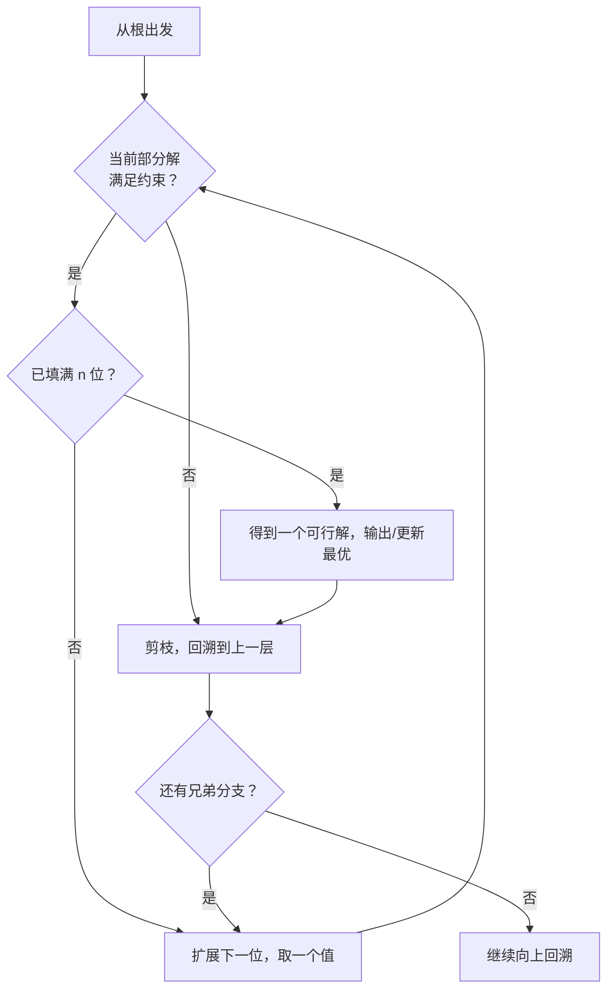
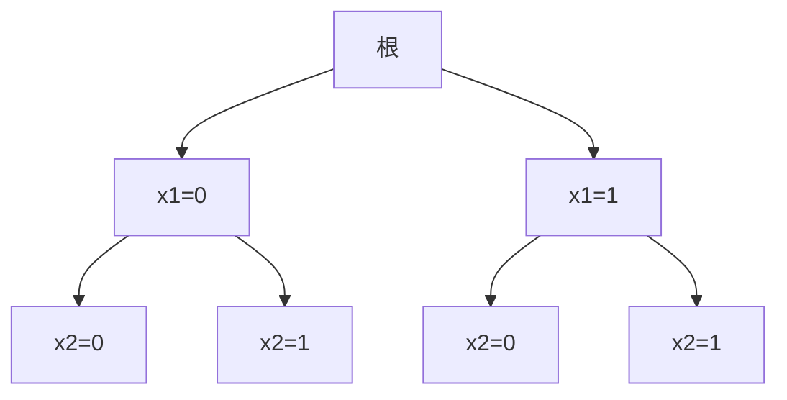

# 7.1 回溯法的基本思想、解空间与多米诺性质

## 7.1.1 从“枚举”到“搜索”

组合问题的解可以表示为一个 $n$ 元向量 $(x_1,x_2,\dots,x_n)$，每个分量 $x_i$ 从一个有限集合 $S_i$ 中取值。所有可能的取值组合构成**解空间**，规模为 $|S_1|\times|S_2|\times\cdots\times|S_n|$。

蛮力法逐一检查解空间中的每个向量。但很多部分向量在“还没填完”时就已经注定不可能成为可行解。例如 N 皇后问题中，若前两个皇后已经放在同一列，后面怎么放都不合法——没必要继续枚举。

**回溯法（Backtracking）** 的思想是：

> 从空向量出发，逐步扩展解向量。每扩展一位，就用**约束函数**检查当前部分解是否可能长成可行解；若不可能，立即“回头”（回溯），尝试该位的下一个取值；若可能，继续扩展下一位。直到得到一个完整解，或所有分支都试完。

用一句话概括：**深度优先搜索解空间树 + 剪枝**。



## 7.1.2 解空间的三种典型结构

### 子集树

当每个分量只取 $0/1$ 时，解空间是一棵**子集树**：第 $i$ 层决定第 $i$ 个元素选或不选，叶子数为 $2^n$。典型问题：0-1 背包、装载、最大团、集合覆盖。



### 排列树

当解是 $1..n$ 的一个排列时，解空间是一棵**排列树**：第 $i$ 层从剩余元素中选一个放到第 $i$ 位，叶子数为 $n!$。典型问题：TSP、批作业调度、全排列、N 皇后（若按行放置，每行选一列，也是排列结构的一种变体）。

### $m$ 叉树

当每个分量有 $m$ 种取值时，解空间是一棵 $m$ 叉树，叶子数为 $m^n$。典型问题：图的 $m$ 着色、数独。

| 结构 | 分支因子 | 叶子数 | 典型问题 |
| :--- | :--- | :--- | :--- |
| 子集树 | 2 | $2^n$ | 0-1 背包、装载、最大团 |
| 排列树 | $n-i+1$ | $n!$ | TSP、批作业调度 |
| $m$ 叉树 | $m$ | $m^n$ | 图着色、数独 |

## 7.1.3 显式约束与隐式约束

- **显式约束（explicit constraint）**：对每个分量 $x_i$ 取值范围的直接限定。例如 $x_i\in\{1,2,\dots,n\}$、$x_i\in\{0,1\}$。
- **隐式约束（implicit constraint）**：为满足问题的解而对不同分量之间施加的约束。例如 N 皇后中“任意两个皇后不在同一列、同一对角线”，TSP 中“相邻城市之间有边、每个城市只访问一次、最后回到起点”。

::: info 以 TSP 为例
- 解向量：$(x_1,x_2,\dots,x_n)$，表示访问顺序；
- 显式约束：$x_i\in\{1,2,\dots,n\}$；
- 隐式约束：$(x_i,x_{i+1})\in E$，$x_i\ne x_k$（$i\ne k$），$(x_n,x_1)\in E$。

显式约束决定了树的形状（$n$ 叉），隐式约束决定了哪些分支可以被剪掉。
:::

## 7.1.4 多米诺性质

回溯法能正确剪枝的前提，是问题满足**多米诺性质（Domino property）**：

> 设 $P(x_1,x_2,\dots,x_i)$ 是关于部分向量 $\langle x_1,\dots,x_i\rangle$ 的某个性质。若
>
> $$P(x_1,\dots,x_{i+1})\ \Longrightarrow\ P(x_1,\dots,x_i)\qquad(0<i<n)$$
>
> 则称 $P$ 满足多米诺性质。

换句话说：**若一个更长的部分向量是合法的，那么它的所有前缀也一定合法**。逆否命题是：**若某个前缀不合法，则任何以它为前缀的完整向量都不合法**——这正是剪枝的依据。

::: warning 多米诺性质不成立时不能随便剪枝
若问题不满足多米诺性质，当前部分解“暂时不合法”并不代表扩展后一定不合法，剪掉它可能漏掉真正的解。此时要么换一种约束表示，要么只能枚举到底再判断。

例如某些“全局约束”（如“最终总和必须为偶数”）无法在部分解阶段判断，就不能作为剪枝条件。
:::

## 7.1.5 回溯法的适用条件与特点

| 维度 | 说明 |
| :--- | :--- |
| 适用问题 | 组合搜索问题（找所有解/一个解）、组合优化问题（找最优解） |
| 必要条件 | 满足多米诺性质 |
| 解的表示 | 解向量，求解过程是不断扩充解向量的过程 |
| 搜索方式 | 深度优先 |
| 剪枝依据 | 约束函数（可行性）、界函数（最优性） |
| 最坏复杂度 | 指数级（$2^n$、$n!$、$m^n$） |
| 空间 | $O(n)$（递归栈 + 解向量），空间代价小 |
| 优点 | 通用、易实现、空间省、平均性能常远好于最坏 |
| 缺点 | 最坏仍是指数级，剪枝设计依赖问题结构 |

::: tip 回溯法与蛮力法的区别
- 蛮力法：**生成所有候选解**，再逐一检验；
- 回溯法：**边生成边检验**，不合法立即停止。

两者最坏复杂度相同，但回溯法通过剪枝，平均性能通常好得多。可以把回溯法看作“带剪枝的深度优先蛮力搜索”。
:::

## 7.1.6 一个直观例子：N 皇后

在 $N\times N$ 的棋盘上放置 $N$ 个皇后，使任意两个皇后不在同一行、同一列、同一对角线。

- 解向量：$(x_1,x_2,\dots,x_N)$，$x_i$ 表示第 $i$ 行皇后所在的列；
- 显式约束：$x_i\in\{1,2,\dots,N\}$；
- 隐式约束：
  - 不同列：$x_i\ne x_j$；
  - 不同对角线：$|x_i-x_j|\ne|i-j|$。

搜索过程：

```plaintext
<1>
<1,3>       // 第 2 行不能放 1、2，放 3
<1,3,5>     // 第 3 行不能放 1、3、4，放 5
<1,3,5,2>   // 第 4 行不能放 1、3、5、...，放 2
<1,3,5,2,4> // 得到一个解
```

若在某一行找不到合法列，就回溯到上一行，换一个列继续。N 皇后是回溯法最经典的教学案例，下一节会给出完整代码。

::: info 回溯法的“三条线”
学习任何一个回溯算法，都先画出这三条线：

1. **解向量线**：$x_1,x_2,\dots,x_n$ 分别表示什么？
2. **约束线**：显式约束与隐式约束分别是什么？如何 $O(1)$ 或 $O(n)$ 判断？
3. **搜索线**：哪一层对应哪个决策？叶子对应什么？如何回溯（恢复现场）？

三条线理清，代码自然就出来了。
:::
