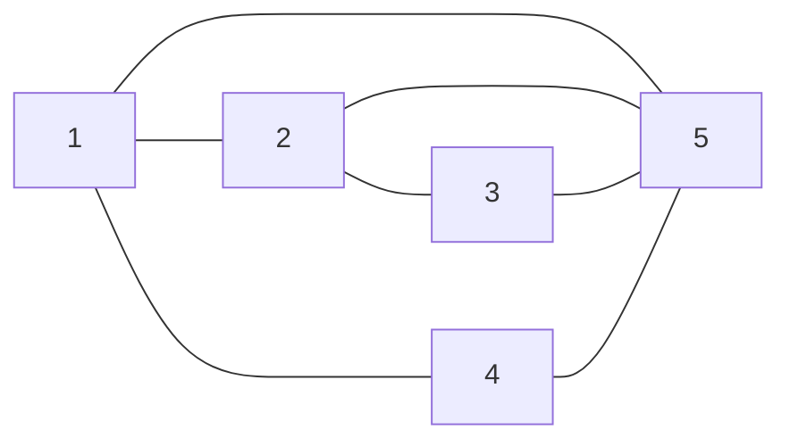

# 7.4 典型应用（二）：装载、0-1 背包、最大团与效率分析

## 7.4.1 装载问题

### 问题

有 $n$ 个集装箱要装上两艘载重量分别为 $c_1$、$c_2$ 的轮船，第 $i$ 个集装箱重量为 $w_i$，且 $\sum w_i\le c_1+c_2$。问是否存在合理装载方案？若有，给出一种方案。

一个关键观察：**若问题有解，则一定可以按“先把第一艘船尽可能装满，再把剩余装上第二艘船”的方式装载**。因此问题转化为：选取一个子集，使重量之和不超过 $c_1$ 且尽可能大——这是特殊的 0-1 背包（每件物品价值等于重量）。

### 建模

- 解向量：$(x_1,\dots,x_n)$，$x_i\in\{0,1\}$ 表示第 $i$ 个集装箱是否装上第一艘船；
- 约束：$\sum w_i x_i\le c_1$；
- 目标：最大化 $\sum w_i x_i$。

解空间是一棵**子集树**。

### 回溯实现

维护：

- `cw`：当前已装重量；
- `r`：剩余可选集装箱的总重量；
- `bestw`：当前最优载重量；
- `x[]`、`bestx[]`：当前解与最优解。

```java
void backtrack(int i) {
    if (i > n) {
        if (cw > bestw) {
            bestw = cw;
            bestx = x.clone();
        }
        return;
    }
    r -= w[i];

    // 左子树：装入第 i 个
    if (cw + w[i] <= c1) {
        x[i] = 1;
        cw += w[i];
        backtrack(i + 1);
        cw -= w[i];              // 恢复现场
    }

    // 右子树：不装第 i 个，用上界剪枝
    if (cw + r > bestw) {
        x[i] = 0;
        backtrack(i + 1);
    }

    r += w[i];                   // 恢复现场
}
```

- **约束剪枝**：`cw + w[i] <= c1`，左子树必须满足容量；
- **界剪枝**：`cw + r > bestw`，若“当前载重 + 剩余全部重量”都不如已知最优，右子树不可能产生更好的解。

### 复杂度

最坏 $O(2^n)$。若所有集装箱都能装下，左分支一路走到底，右分支被大量剪掉，实际接近 $O(n)$。

::: tip 为什么右子树才用界剪枝？
左子树表示“装入”，它可能直接改进 `bestw`，不能因为当前上界不够就剪掉；右子树表示“不装”，若连“把剩余全装上”都超不过 `bestw`，那这条分支确实没有希望。
:::

## 7.4.2 0-1 背包问题

### 回溯建模

- 解向量：$x_i\in\{0,1\}$；
- 约束：$\sum w_i x_i\le c$；
- 目标：最大化 $\sum v_i x_i$。

与装载问题相比，这里“重量”和“价值”是两回事，界函数需要更精细。

### 上界函数

设当前已装价值为 `cv`，剩余容量为 `c - cw`。把剩余物品按**单位价值降序**排列，用分数背包的贪心思想估计一个上界：

```java
double bound(int i) {
    double cleft = c - cw;       // 剩余容量
    double b = cv;               // 当前价值
    while (i <= n && w[i] <= cleft) {
        cleft -= w[i];
        b += v[i];
        i++;
    }
    if (i <= n) b += v[i] * cleft / w[i];   // 装一部分
    return b;
}
```

这个上界是**松弛**后的最优值：允许把物品切开，因此一定不小于真实的 0-1 最优值。若 `bound(i) <= bestp`，当前分支不可能更好，剪枝。

### 回溯实现

```java
void backtrack(int i) {
    if (i > n) {
        if (cv > bestp) {
            bestp = cv;
            bestx = x.clone();
        }
        return;
    }
    if (cw + w[i] <= c) {          // 左子树：装入
        x[i] = 1;
        cw += w[i];
        cv += v[i];
        backtrack(i + 1);
        cw -= w[i];
        cv -= v[i];
    }
    if (bound(i + 1) > bestp) {    // 右子树：不装
        x[i] = 0;
        backtrack(i + 1);
    }
}
```

::: warning 排序会打乱解的编号
为了让 `bound` 中的贪心上界有效，通常预先按 $v_i/w_i$ 降序排序。但排序后 $x_i$ 对应的不再是原物品编号，最后需要用一个映射数组还原。考试答题时若不在意输出顺序，可以省略还原步骤，但要说明“已按单位价值排序”。
:::

### 复杂度

最坏 $O(2^n)$。上界越紧，剪枝越强。对随机数据，回溯法通常能在远小于 $2^n$ 的时间内求出最优解；但对最坏数据（如所有物品单位价值相同），仍可能接近 $2^n$。

## 7.4.3 最大团问题

### 定义

给定无向图 $G=(V,E)$：

- **完全子图**：$U\subseteq V$，且对任意 $u,v\in U$ 都有 $(u,v)\in E$；
- **团（clique）**：$G$ 的完全子图 $U$，且 $U$ 不包含在 $G$ 的更大的完全子图中；
- **最大团**：$G$ 中所含顶点数最多的团。

例如下图中，$\{1,2,5\}$、$\{1,4,5\}$、$\{2,3,5\}$ 都是大小为 $3$ 的最大团。



### 建模

- 解向量：$x_i\in\{0,1\}$，表示顶点 $i$ 是否选入团；
- 约束：选中的顶点两两相邻；
- 目标：最大化 $\sum x_i$。

解空间是子集树。

### 剪枝

- **约束**：进入左子树（选顶点 $i$）前，检查 $i$ 是否与当前团中所有顶点相邻；
- **界**：当前团大小 `cn` 加上“剩余可选顶点数” `n-i`，若不超过 `bestn`，右子树无望。

$$cn+(n-i)\le bestn\quad\Longrightarrow\quad\text{剪枝}$$

### 实现

```java
void backtrack(int i) {
    if (i > n) {
        if (cn > bestn) {
            bestn = cn;
            bestx = x.clone();
        }
        return;
    }
    if (ok(i)) {                 // 左子树：选 i
        x[i] = 1;
        cn++;
        backtrack(i + 1);
        cn--;
    }
    if (cn + n - i > bestn) {    // 右子树：不选 i
        x[i] = 0;
        backtrack(i + 1);
    }
}

boolean ok(int i) {
    for (int j = 1; j < i; j++)
        if (x[j] == 1 && !a[i][j]) return false;
    return true;
}
```

::: tip 最大团与最大独立集
图 $G$ 的最大团，等于其**补图** $\bar G$ 的最大独立集。补图中两点相邻当且仅当原图中两点不相邻。因此求最大独立集可以转化为求补图的最大团，代码完全复用。
:::

### 复杂度

最坏 $O(2^n)$。若图很稠密，`ok(i)` 很容易通过，搜索树接近满二叉树；若图很稀疏，剪枝很强。

## 7.4.4 回溯法的效率分析

### 影响效率的四个因素

1. **产生 $x[k]$ 的时间**；
2. **计算约束函数 `constraint` 的时间**；
3. **计算界函数 `bound` 的时间**；
4. **满足约束与界函数的结点个数**。

前三个是“单结点成本”，第四个是“结点总数”。优化时先看哪个是瓶颈：

- 若单结点成本高（如 `check` 是 $O(n)$），用布尔数组/位运算/增量式更新降到 $O(1)$；
- 若结点总数大，设计更强的剪枝、更好的搜索顺序、对称性消除。

### 搜索顺序的影响

在同一层，先试哪个候选值，会显著影响剪枝效果。

::: details 一个经典图示
假设某问题有两个解空间树 (a) 和 (b)。在 (a) 中，从第 2 层剪掉一棵子树，一次消去 $12$ 个叶子；在 (b) 中，从第 1 层剪掉一棵子树，却只消去 $8$ 个叶子。

虽然 (b) 剪的层更高，但 (a) 剪掉的叶子更多——**剪枝的效果取决于被剪子树的大小，而不只是剪枝的层数**。因此，把“更可能失败”的分支放在前面，可以更早剪掉大子树。
:::

常用策略：

- **最受约束优先（fail-first）**：先处理可选值最少的变量，让冲突尽早暴露；
- **最有希望优先**：先试最可能得到好解的值，尽快更新 `best`，让界剪枝更早生效；
- **对称性消除**：若解在某种置换下等价，只搜索代表元（如 N 皇后第一行只放前半列，再乘对称数）。

### 空间复杂度

回溯法只需保存：

- 解向量 $x[1..n]$；
- 递归栈（深度 $n$）；
- 少量辅助状态（`cw`、`cv`、`cc`、标记数组等）。

因此空间为 $O(n)$ 或 $O(n^2)$（若需要邻接矩阵），远小于动态规划的表格。这是回溯法相对于 DP 的一大优势。

### 回溯法与分支限界法的初步对比

| 维度 | 回溯法 | 分支限界法 |
| :--- | :--- | :--- |
| 搜索方式 | 深度优先 | 广度优先 / 优先队列 |
| 活结点存储 | 递归栈（隐式） | 显式队列/堆 |
| 目标 | 所有解或一个最优解 | 通常求一个最优解 |
| 剪枝 | 约束 + 界 | 约束 + 界（更依赖界） |
| 空间 | $O(n)$ | 可能指数级（存活结点） |
| 适用 | 找所有解、约束强的问题 | 求最优解、希望尽快找到好解 |

::: info 回溯法的总结
- **适用**：组合搜索问题（含组合优化问题）；
- **条件**：满足多米诺性质；
- **解的表示**：解向量，求解是不断扩充解向量的过程；
- **回溯条件**：约束条件或界条件；
- **复杂度**：最坏指数级，空间代价小；
- **降低时间复杂性的主要途径**：利用界函数对搜索树剪枝，难点在于界的设计。

考试中，回溯法常以“补全代码 + 分析复杂度 + 说明剪枝条件”的形式出现。把 N 皇后、装载、0-1 背包、最大团、TSP 这五个模板背熟，足以应对绝大多数题目。
:::
