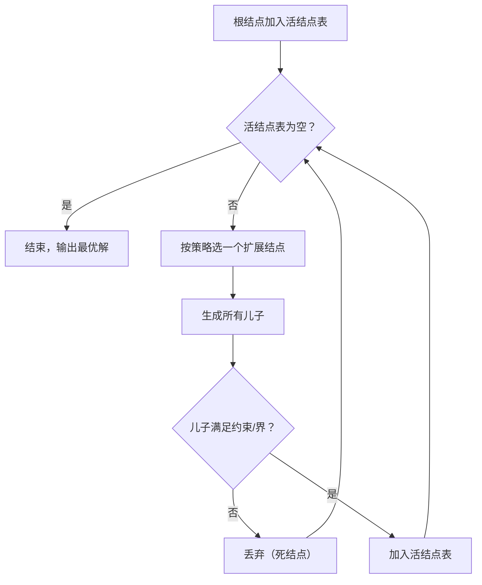

# 8.1 分支限界法的基本思想与界

## 8.1.1 从“一条路走到黑”到“同时保留多个选择”

回溯法在解空间树上做深度优先搜索：选择一个分支后，一直往下走，直到走不通或得到解，才回头尝试兄弟分支。它的活结点（还可以继续扩展的结点）隐含在递归栈中，同一时刻只有一条路径。

**分支限界法（Branch and Bound）** 换了一种搜索方式：

- 维护一个**活结点表**，同时保留多个待扩展的结点；
- 每次从表中选一个结点作为**扩展结点**，一次性生成它的所有儿子；
- 用**约束函数**和**界函数**判断儿子是否可能产生最优解，不可能的立即丢弃（成为死结点）；
- 直到活结点表为空，或找到一个足够好的解。

### 三种结点

| 名称 | 含义 |
| :--- | :--- |
| **活结点** | 自身已生成，但儿子还未全部生成的结点 |
| **扩展结点** | 当前正在生成儿子的活结点 |
| **死结点** | 儿子已全部生成，或被剪枝，不再扩展的结点 |

## 8.1.2 与回溯法的区别

| 维度 | 回溯法 | 分支限界法 |
| :--- | :--- | :--- |
| 搜索方式 | 深度优先 | 广度优先 / 最佳优先 |
| 活结点存储 | 递归栈（隐式） | 队列或优先队列（显式） |
| 扩展方式 | 每次扩展一个儿子，递归深入 | 一次生成全部儿子 |
| 目标 | 找所有解，或一个解 | 通常找一个最优解 |
| 空间 | $O(n)$ | 最坏指数级（存活的结点） |
| 剪枝依据 | 约束 + 界 | 约束 + 界（更依赖界） |
| 适用 | 约束强、解多 | 优化问题、希望尽快得到好解 |

::: tip 一句话选择
- 要**列出所有解**、约束很强、内存紧张 → 回溯法；
- 要求**一个最优解**、界容易估计、希望尽早剪枝 → 分支限界法。
:::

## 8.1.3 上界与下界

分支限界法的核心是“界”。对每个结点 $v$，估计从 $v$ 出发能得到的所有完整解的目标值范围：

- **上界 $UB(v)$**：从 $v$ 出发得到的所有叶子结点的目标值都**不大于** $UB(v)$；
- **下界 $LB(v)$**：从 $v$ 出发得到的所有叶子结点的目标值都**不小于** $LB(v)$；
- 若某个叶子能达到 $UB(v)$，称 $UB(v)$ 为**上确界**（同理下确界）。

设当前已找到的最好可行解目标值为 `cBest`。

### 极大化问题（求最大值）

若

$$UB(v)\le cBest$$

则结点 $v$ 的整棵子树都不可能产生更好的解，可以剪枝（加入“黑名单”）。

- $UB$ 越**小**越紧（越接近真实最优值），剪枝越强；
- $LB$ 可以用贪心得到一个可行解，作为 `cBest` 的初始值。

### 极小化问题（求最小值）

若

$$LB(v)\ge cBest$$

则结点 $v$ 可以剪枝。

- $LB$ 越**大**越紧；
- $UB$ 可以用贪心得到一个可行解，作为 `cBest` 的初始值。

| 问题类型 | 剪枝条件 | 好的界 | 如何快速得到初始解 |
| :--- | :--- | :--- | :--- |
| 极大化 | $UB(v)\le cBest$ | $UB$ 越小越好 | 贪心求下界作为 $cBest$ |
| 极小化 | $LB(v)\ge cBest$ | $LB$ 越大越好 | 贪心求上界作为 $cBest$ |

::: warning 界的“方向”不要搞反
极大化问题中，$UB$ 是“乐观估计”，它必须**不小于**真实最优值，否则会误剪掉最优解；$LB$ 是“保守估计”，可以是一个可行解的值。极小化问题正好相反。考试中写剪枝条件时，先问自己：“这个界是乐观还是保守？比较符号对不对？”
:::

## 8.1.4 界从哪里来

界的估计通常有两条路：

1. **松弛**：把问题变得更容易求解（如允许物品分割、允许重复访问、忽略某些约束），得到的新问题的最优值是原问题的界；
2. **贪心**：用贪心策略构造一个可行解，作为另一个方向的界。

以 0-1 背包为例：

- **上界（极大化）**：把 0-1 背包松弛为分数背包，按单位价值贪心，允许最后一件拆分。得到的是乐观上界。
- **下界（极大化）**：按单位价值贪心，但**不允许拆分**，装不下就跳过。得到的是一个可行解，其价值是下界。

### 例：一个精确的例子

$n=3$，$C=30$，$w=\{16,15,15\}$，$v=\{28,30,30\}$。按单位价值排序：物品 2（$2$）、物品 3（$2$）、物品 1（$1.75$）。

- **下界**：按贪心依次装物品 2、3，总重 $30$，价值 $60$，得到可行解 $(0,1,1)$，故 $LB(v_0)=60$；
- **上界**：剩余容量恰好为 $0$，分数背包也只能装 $60$，故 $UB(v_0)=60$。

$LB(v_0)=UB(v_0)=60$，说明已经找到最优解，无需再搜索。

## 8.1.5 界的设计原则

| 原则 | 说明 |
| :--- | :--- |
| **有效性** | 界必须覆盖所有可能解，不能把最优解剪掉 |
| **紧致性** | 界越接近真实最优值，剪枝越强 |
| **可计算性** | 界函数本身要足够快，通常是 $O(n)$ 或 $O(n\log n)$ |
| **单调性** | 从父结点到子结点，上界不应增大、下界不应减小（便于增量更新） |

::: tip 界太松怎么办？
- 用更强的松弛：加入更多约束、使用线性规划松弛；
- 用组合下界：TSP 中用最小生成树、最小 1-树；
- 用贪心构造更好的初始解，提高 `cBest`；
- 用优先队列，优先扩展界最好的结点，尽快到达叶子、更新 `cBest`。
:::

## 8.1.6 分支限界法的终止条件

- **队列为空**：所有结点都已扩展或剪枝，算法结束；
- **找到叶子**：在优先队列式搜索中，若按上界（极大化）从大到小扩展，**第一个被取出的叶子结点就是最优解**。因为队列中其余结点的上界都不超过它，不可能产生更好的解。

::: info 为什么第一个叶子就是最优？
优先队列按 $UB$ 降序排列。当叶子 $v$ 被取出时，$UB(v)=LB(v)=$ 该叶子的目标值（叶子没有剩余决策）。队列中其他结点的 $UB$ 都 $\le UB(v)$，所以它们能产生的任何解都不优于 $v$。因此 $v$ 是最优解。
:::
