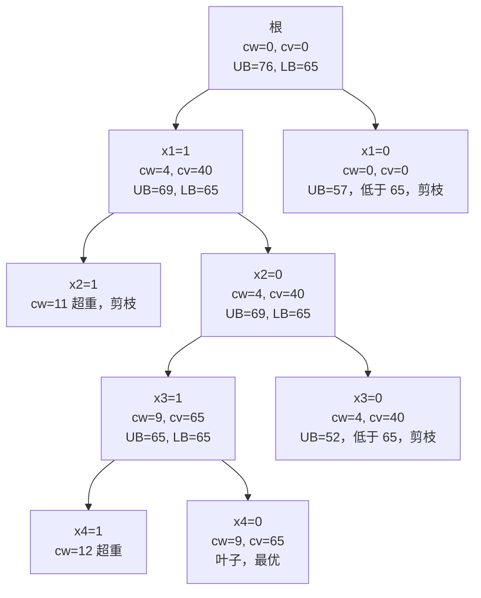

# 8.4 0-1 背包问题

## 8.4.1 问题回顾

$n$ 件物品，第 $i$ 件重 $w_i$、价值 $v_i$，背包容量 $c$，每件物品只能选或不选，求最大总价值。

分支限界法的思路：

- 解空间：子集树；
- 约束：$cw+w_i\le c$；
- 上界：把剩余物品按单位价值贪心，允许拆分，得到一个乐观估计；
- 下界：按单位价值贪心但不拆分，得到一个可行解；
- 搜索策略：优先队列，按上界从大到小扩展。

## 8.4.2 上界函数

设当前结点已决定前 $i$ 件物品，当前价值 `cv`、当前重量 `cw`，剩余容量 `c - cw`。把剩余物品按 $v/w$ 降序排列，做分数背包：

- 能整件装下的，全部装入；
- 遇到装不下的，装入一部分，然后停止。

得到的就是上界 $UB$。

::: tip 两种上界写法
**写法一（标准分数背包）**：遇到第一件装不下的物品，就按剩余容量比例装入，停止。

**写法二（先剔除装不下的整件）**：若某件物品的重量大于当前剩余容量，它在 0-1 中根本不可能被选，直接跳过；对剩余物品再做分数背包。

写法二得到的界更紧（更小），剪枝更强。课件中的例子使用的就是写法二。
:::

```java
double bound(Node u) {
    double left = c - u.cw;
    double b = u.cv;
    double originalLeft = left;
    for (int i = u.level + 1; i <= n; i++) {
        if (w[i] <= left) {              // 整件装得下
            left -= w[i];
            b += v[i];
        } else if (w[i] > originalLeft) { // 这件在当前结点永远装不下
            continue;
        } else {                          // 装一部分
            b += v[i] * left / w[i];
            break;
        }
    }
    return b;
}
```

## 8.4.3 结点结构与算法

```java
class Node {
    int level;          // 已决定的物品数
    int cw, cv;         // 当前重量、价值
    double ub;          // 上界
    Node parent;
    boolean leftChild;
}
```

```java
double knapsackBB(int n, int c, int[] w, int[] v) {
    // 预先按 v[i]/w[i] 降序排序，并用 bestP 记录当前最优
    PriorityQueue<Node> heap = new PriorityQueue<>(
        (a, b) -> Double.compare(b.ub, a.ub));   // 最大堆

    Node root = new Node();
    root.level = 0; root.cw = 0; root.cv = 0;
    root.ub = bound(root);
    heap.add(root);

    double bestP = 0;
    Node bestNode = null;

    while (!heap.isEmpty()) {
        Node u = heap.poll();
        if (u.ub <= bestP) continue;      // 界剪枝
        if (u.level == n) {               // 叶子
            if (u.cv > bestP) { bestP = u.cv; bestNode = u; }
            continue;
        }
        int i = u.level + 1;

        // 左儿子：装入
        if (u.cw + w[i] <= c) {
            Node l = new Node();
            l.level = i; l.cw = u.cw + w[i]; l.cv = u.cv + v[i];
            l.parent = u; l.leftChild = true;
            l.ub = bound(l);
            if (l.ub > bestP) heap.add(l);
        }

        // 右儿子：不装
        Node r = new Node();
        r.level = i; r.cw = u.cw; r.cv = u.cv;
        r.parent = u; r.leftChild = false;
        r.ub = bound(r);
        if (r.ub > bestP) heap.add(r);
    }
    return bestP;
}
```

::: warning 上界必须是“从该结点出发的最终价值”
`bound(u)` 返回的是 $u.cv$ 加上剩余物品的分数价值，即“如果从 $u$ 一路走到叶子，最终总价值最多是多少”。只有所有结点的界都是同一含义，优先队列的比较才有意义。
:::

## 8.4.4 算例

$n=4$，$c=10$，物品按单位价值降序排列：

| 物品 | $w$ | $v$ | $v/w$ |
| :--- | ---: | ---: | ---: |
| 1 | 4 | 40 | 10 |
| 2 | 7 | 42 | 6 |
| 3 | 5 | 25 | 5 |
| 4 | 3 | 12 | 4 |

### 根结点

- **下界**（0-1 贪心）：装物品 1（$w=4$，$v=40$），物品 2 装不下（$4+7>10$），装物品 3（$w=9$，$v=65$），物品 4 装不下。故 $LB=65$；
- **上界**（分数背包）：根结点剩余容量 $10$。物品 1 整件装入（$w=4$，$v=40$），剩 $6$；物品 2 重 $7>6$，按分数装入 $6/7$，价值 $36$，停止。

$$UB=40+36=76$$

所以根结点 $UB=76$，$LB=65$。

::: tip 到了子结点，上界写法可以更紧
根结点用标准分数背包（遇到装不下的就按比例装入）得到 $76$。到了结点 A（已装物品 1，剩 $6$），物品 2 重 $7>6$，在 0-1 中根本不可能选，可以先剔除它，再对剩余物品做分数背包，得到更紧的上界 $69$。两种写法都是合法上界，后者剪枝更强。
:::


### 搜索树



### 逐结点说明

| 结点 | 决策 | $cw$ | $cv$ | $UB$ | 处理 |
| :--- | :--- | ---: | ---: | ---: | :--- |
| 根 | — | 0 | 0 | 76 | 扩展 |
| A | $x_1=1$ | 4 | 40 | 69 | 扩展 |
| B | $x_1=0$ | 0 | 0 | 57 | $57<65$，剪枝 |
| C | $x_1=1,x_2=1$ | 11 | — | — | 超重，剪枝 |
| D | $x_1=1,x_2=0$ | 4 | 40 | 69 | 扩展 |
| E | $x_1=1,x_2=0,x_3=1$ | 9 | 65 | 65 | 扩展 |
| F | $x_1=1,x_2=0,x_3=0$ | 4 | 40 | 52 | $52<65$，剪枝 |
| G | $x_4=1$ | 12 | — | — | 超重，剪枝 |
| H | $x_4=0$ | 9 | 65 | 65 | 叶子，最优 |

最优解 $x=(1,0,1,0)$，最大价值 $65$。

::: info 关于结点 A 的上界 69
结点 A 已装物品 1，剩余容量 $6$。按“先剔除装不下的整件”的写法：

- 物品 2 重 $7>6$，0-1 中不可能选，跳过；
- 物品 3 重 $5\le6$，整件装入，价值 $25$，剩 $1$；
- 物品 4 重 $3>1$，按分数装入 $1/3$，价值 $4$。

$$UB=40+25+4=69$$

若用标准分数背包（不剔除物品 2），则 $UB=40+36=76$。两者都是合法上界，$69$ 更紧，剪枝更强。课件中结点 F 标注的上界为 $64$，按“剩余物品整件装入”计算应为 $52$；两者都小于 $65$，不影响剪枝结论。
:::

## 8.4.5 复杂度与讨论

- 最坏情况：$O(2^n)$ 个结点，每个结点计算上界 $O(n)$，总时间 $O(n2^n)$；
- 空间：优先队列可能存 $O(2^n)$ 个结点；
- 实际性能：上界越紧、初始下界越好，剪枝越强。对随机数据，通常远快于 $2^n$。

| 方法 | 时间 | 空间 | 特点 |
| :--- | :--- | :--- | :--- |
| 蛮力枚举 | $O(n2^n)$ | $O(n)$ | 最简单 |
| 动态规划 | $O(nc)$ | $O(nc)$ / $O(c)$ | 伪多项式，容量大时慢 |
| 回溯法 | 最坏 $O(2^n)$ | $O(n)$ | 深度优先，空间省 |
| 分支限界（FIFO） | 最坏 $O(2^n)$ | $O(2^n)$ | 层序扩展 |
| 分支限界（优先队列） | 最坏 $O(2^n)$ | $O(2^n)$ | 通常最快找到最优 |

::: tip 什么时候用分支限界而不是 DP？
- 容量 $c$ 很大（如 $10^9$），DP 的 $O(nc)$ 不可行；
- $n$ 较小（如 $n\le50$），但容量很大；
- 物品的单位价值差异大，上界剪枝效果明显。

反之，若 $n$ 很大而 $c$ 较小，DP 的 $O(nc)$ 更稳定。
:::

## 8.4.6 考试要点

1. 能写出 0-1 背包的分支限界解空间、约束、上界；
2. 能计算一个结点的 $UB$ 与 $LB$，并判断是否剪枝；
3. 能画出优先队列的扩展顺序（按 $UB$ 从大到小）；
4. 能说明“第一个被取出的叶子就是最优解”；
5. 能比较 DP、回溯、分支限界的适用场景。
