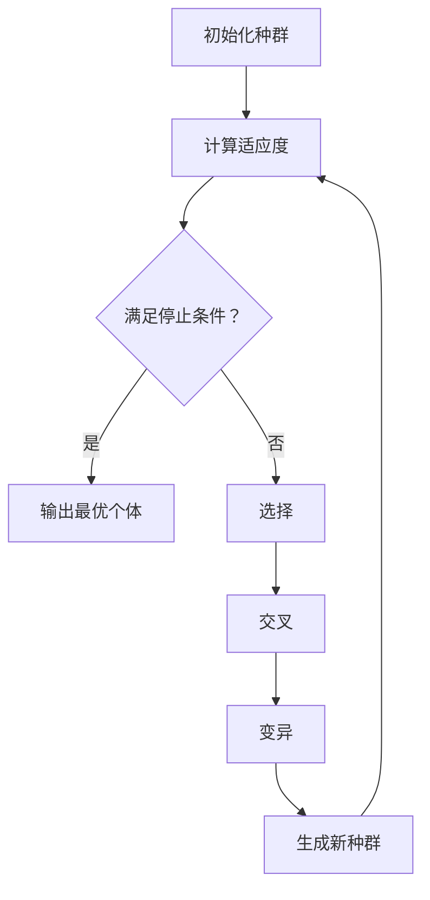

# 9.1 遗传算法的起源与基本思想

## 9.1.1 起源

遗传算法（Genetic Algorithm, GA）由美国 Michigan 大学的 **J. Holland 教授**于 1975 年在其专著《自然界和人工系统的适应性》（*Adaptation in Natural and Artificial Systems*）中首先提出。它是一类**借鉴生物界自然选择和自然遗传机制的随机化搜索算法**。

生物进化的三个基本机制，被直接映射到算法中：

| 生物机制 | 算法对应 | 作用 |
| :--- | :--- | :--- |
| 染色体/基因 | 编码后的解 | 表示候选解 |
| 个体/种群 | 一组解 | 并行搜索 |
| 适应度 | 目标函数值 | 评价解的好坏 |
| 自然选择 | 选择算子 | 优胜劣汰 |
| 繁殖/杂交 | 交叉算子 | 组合优良基因 |
| 基因突变 | 变异算子 | 保持多样性 |

## 9.1.2 基本思想

遗传算法把问题的解编码成“染色体”（通常是二进制串或排列），把一组解称为“种群”。每一代：

1. **评价**：计算每个个体的适应度；
2. **选择**：按适应度高低，以一定概率选出较优个体作为父代；
3. **交叉**：让父代两两交换部分基因，产生新个体；
4. **变异**：以很小的概率随机改变某些基因；
5. **更新种群**：用新个体替换旧个体，形成下一代；
6. 重复上述过程，直到满足停止条件。

::: info 遗传算法与“爬山”的区别
传统优化方法（如梯度下降、爬山法）从一个点出发，沿着改进方向移动，容易陷入局部最优。遗传算法同时维护**一群**点，通过交叉在不同区域之间“跳跃”，通过变异跳出局部区域，因此具有更强的**全局搜索能力**。代价是计算量大、结果具有随机性。
:::

## 9.1.3 核心术语

| 术语 | 含义 |
| :--- | :--- |
| **染色体（chromosome）** | 一个解的编码表示，也称个体（individual） |
| **基因（gene）** | 染色体上的一个位置/一位编码 |
| **种群（population）** | 当前代所有个体的集合 |
| **种群规模 $M$** | 种群中个体的数量 |
| **适应度（fitness）** | 衡量个体优劣的数值，越大越好 |
| **编码（encoding）** | 把问题的解表示为染色体 |
| **解码（decoding）** | 把染色体还原为问题的解 |
| **选择（selection）** | 按适应度挑选父代 |
| **交叉（crossover）** | 两个父代交换部分基因 |
| **变异（mutation）** | 随机改变个别基因 |
| **精英保留（elitism）** | 把当代最优个体直接保留到下一代 |
| **代数（generation）** | 进化的轮次 |

## 9.1.4 编码方式

编码是遗传算法的第一步，直接决定交叉、变异算子的设计。

### 二进制编码

把解表示为 0/1 串。例如求 $x\in[0,10]$ 的最大值，用 22 位二进制表示：

$$x=\frac{\text{decimal}(b_{21}b_{20}\cdots b_0)}{2^{22}-1}\times10$$

| 优点 | 缺点 |
| :--- | :--- |
| 简单、通用，交叉变异易实现 | 精度与串长矛盾；连续函数有“汉明悬崖” |
| 理论分析成熟（模式定理） | 高维问题串太长 |

::: tip 格雷码
普通二进制中，相邻两个数可能有多位不同（如 $3=011$、$4=100$，三位全变），交叉/变异容易产生剧烈跳变。格雷码让相邻数的编码只差一位，能缓解“汉明悬崖”，改善局部搜索能力。
:::

### 实数编码

直接用实数向量 $(x_1,\dots,x_n)$ 作为染色体，交叉用算术交叉（如 $x'=\alpha x+(1-\alpha)y$），变异加高斯扰动。

优点：适合连续优化，精度高，无需解码；缺点：交叉变异的设计更依赖问题。

### 排列编码

当解是 $1..n$ 的一个排列（如 TSP、调度），染色体就是排列。普通交叉会产生重复/缺失的城市，需要专门的交叉算子（OX、PMX）或修复操作。

### 其他编码

- **整数编码**：每个基因取有限个整数值；
- **树编码**：用于遗传编程，表示表达式树；
- **混合编码**：不同基因用不同类型。

| 编码 | 适用问题 | 交叉/变异特点 |
| :--- | :--- | :--- |
| 二进制 | 函数优化、组合优化 | 单点交叉、位变异 |
| 实数 | 连续函数优化 | 算术交叉、高斯变异 |
| 排列 | TSP、调度 | OX/PMX、交换/逆转变异 |
| 树 | 符号回归、程序合成 | 子树交换、子树变异 |

## 9.1.5 遗传算法的特点

| 优点 | 局限 |
| :--- | :--- |
| 群体搜索，全局能力强 | 无最优性保证，结果随机 |
| 不依赖梯度，适合黑箱问题 | 参数敏感（$M,P_c,P_m,T$） |
| 易于并行 | 计算量大，评价次数多 |
| 通用性强，稍加修改可迁移 | 可能早熟收敛 |
| 可与其它算法混合 | 编码与算子设计需要经验 |

::: warning 遗传算法不是“万能优化器”
它在解空间大、目标函数不连续、无梯度信息时最有优势；但对于小规模问题，精确算法（DP、分支限界）更快更可靠；对于有良好数学结构的问题，专用算法通常优于 GA。**选择算法要看问题结构，而不是看名气**。
:::
