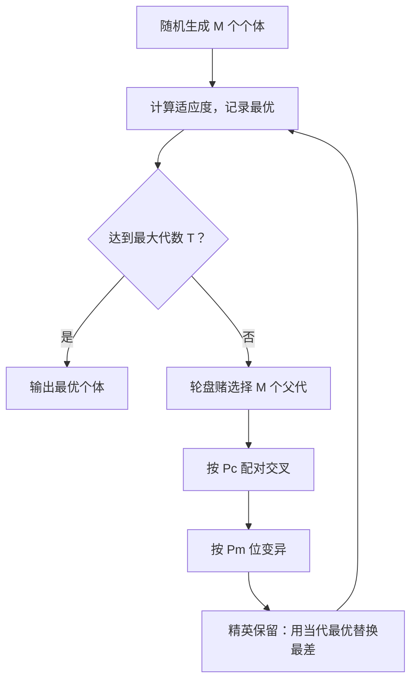

# 9.2 基本遗传算法

## 9.2.1 什么是基本遗传算法

**基本遗传算法（Simple Genetic Algorithms, SGA）** 由 Goldberg 总结提出，又称简单遗传算法或标准遗传算法。它的遗传进化操作过程简单、容易理解，是其它遗传算法的雏形和基础。

SGA 的五个基本要素：

1. **编码**：二进制编码；
2. **初始种群**：随机生成 $M$ 个染色体；
3. **适应度函数**：评价个体优劣；
4. **遗传算子**：选择、交叉、变异；
5. **运行参数**：$M$、$P_c$、$P_m$、$T$。

## 9.2.2 种群初始化

SGA 采用随机方法生成若干个染色体的集合，称为**初始种群**。初始种群中个体的数量称为**种群规模** $M$。

```python
import random

def init_population(M, length):
    return [[random.randint(0, 1) for _ in range(length)] for _ in range(M)]
```

::: tip 初始种群为什么要随机？
随机初始化保证初始个体在解空间中尽量分散，避免一开始就聚集在某个局部区域。若用启发式方法初始化（如贪心解 + 随机扰动），可以提高起点质量，但也可能降低多样性。
:::

## 9.2.3 适应度函数

遗传算法用一个个体（解）的好坏，用**适应度函数值**来评价。设计标准是：**适应度函数值越大，解的质量越好**。适应度函数是进化过程的驱动力，也是进行自然选择的唯一标准。

### 最大化问题

直接取目标函数：

$$F(x)=f(x)$$

例如求一元函数 $f(x)$ 的最大值，染色体解码得到 $x$，适应度就是 $f(x)$。

### 最小化问题

需要把“越小越好”转成“越大越好”，常用：

$$F(x)=\frac{1}{f(x)}\quad\text{或}\quad F(x)=MAX-f(x)$$

其中 $MAX$ 是一个足够大的常数（不小于 $f$ 的最大可能值）。

::: warning 适应度必须非负
轮盘赌选择要求概率非负，因此适应度必须 $F(x)\ge0$。若 $f(x)$ 可能为负，使用 $MAX-f(x)$ 时要保证 $MAX$ 足够大；使用 $1/f(x)$ 时要避免 $f(x)=0$。
:::

### 适应度缩放

若种群中个别个体适应度远高于其他个体，轮盘赌会几乎只选它，导致**早熟收敛**。常用**线性缩放**：

$$F'=\alpha F+\beta$$

使平均适应度保持不变、最大适应度约为平均的 $1.5\sim2$ 倍。此外还有幂函数缩放、指数缩放、排序选择等。

## 9.2.4 选择算子：轮盘赌

遗传算法使用选择运算实现优胜劣汰：适应度高的个体被遗传到下一代的概率大，适应度低的个体概率小。SGA 采用**轮盘赌选择**（比例选择）。

### 原理

设种群大小为 $n$，个体 $i$ 的适应度为 $F_i$，则个体 $i$ 被选中的概率为

$$p_i=\frac{F_i}{\sum_{j=1}^{n}F_j}$$

把每个个体映射为轮盘上的一块扇形，扇形面积与 $p_i$ 成正比；转动轮盘，指针落在哪块就选哪个个体。

### 实现步骤

1. 计算所有个体的适应度 $F_i$；
2. 计算总适应度 $S=\sum F_i$，以及每个个体的累计概率

$$q_i=\sum_{j=1}^{i}p_j$$

3. 生成 $[0,1]$ 上的随机数 $r$，选择满足 $q_{i-1}<r\le q_i$ 的个体 $i$。

```python
def roulette_select(pop, fitness):
    total = sum(fitness)
    r = random.random() * total
    acc = 0
    for i, f in enumerate(fitness):
        acc += f
        if acc >= r:
            return pop[i]
    return pop[-1]
```

::: tip 轮盘赌的缺点
- **随机误差大**：适应度高的个体不一定被选中，适应度低的也可能被选中；
- **早熟**：超级个体占据大部分扇形，种群多样性迅速下降；
- **无法处理负适应度**。

改进方法：**锦标赛选择**（随机选 $k$ 个，取最好的）、**排序选择**（按排名分配概率）、**精英保留**（最优个体直接进入下一代）。
:::

## 9.2.5 交叉算子

交叉运算是指对两个相互配对的染色体，依据交叉概率 $P_c$ 按某种方式交换部分基因，形成两个新个体。交叉是遗传算法区别于其他进化算法的重要特征，是产生新个体的主要方法。

### 单点交叉

在染色体上随机选一个交叉点，交换该点之后的部分：

```text
父代 A: 0 1 1 0 | 1 0 1
父代 B: 1 1 0 1 | 0 0 1
交叉后:
子代 A: 0 1 1 0 | 0 0 1
子代 B: 1 1 0 1 | 1 0 1
```

```python
def single_point_crossover(a, b, pc):
    if random.random() >= pc:
        return a[:], b[:]
    point = random.randint(1, len(a) - 1)
    return a[:point] + b[point:], b[:point] + a[point:]
```

### 其他交叉方式

| 方式 | 做法 | 适用 |
| :--- | :--- | :--- |
| 多点交叉 | 选多个交叉点，交替交换片段 | 二进制 |
| 均匀交叉 | 每一位以 0.5 概率来自父代 A 或 B | 二进制 |
| 算术交叉 | $x'=\alpha x+(1-\alpha)y$ | 实数 |
| OX（顺序交叉） | 保留一段，其余按顺序填充 | 排列（TSP） |
| PMX（部分匹配交叉） | 按位置映射交换 | 排列 |

## 9.2.6 变异算子

变异是指以很小的概率 $P_m$ 随机改变染色体上的某些基因。SGA 采用**基本位变异**：随机选一位，将其取反。

```text
变异前: 0 0 0 0 0 1 1 1 0 0 0 0 0 0 0 1 0 0 0 0 0
变异后: 0 0 0 0 0 1 1 1 0 0 0 1 0 0 0 1 0 0 0 0 0
                          ↑ 变异点
```

```python
def bit_mutation(chrom, pm):
    for i in range(len(chrom)):
        if random.random() < pm:
            chrom[i] ^= 1
    return chrom
```

变异的作用：

- **恢复多样性**：交叉可能让种群趋于一致，变异引入新的基因；
- **局部搜索**：在已有解附近做小扰动；
- **防止早熟**：跳出局部最优。

::: warning 变异概率不能太大
$P_m$ 通常取 $0.001\sim0.01$。若太大，遗传算法退化为随机搜索，优良基因被频繁破坏；若太小，则难以跳出局部最优。
:::

## 9.2.7 一个完整的手算例子

用 SGA 求 $f(x)=x^2$ 的最大值，$x\in[0,31]$ 为整数，用 5 位二进制编码。

初始种群（$M=4$）：

| 个体 | 染色体 | 解码 $x$ | 适应度 $x^2$ | 选择概率 | 累计概率 |
| :--- | :--- | ---: | ---: | ---: | ---: |
| 1 | 01101 | 13 | 169 | 0.144 | 0.144 |
| 2 | 11000 | 24 | 576 | 0.492 | 0.636 |
| 3 | 01000 | 8 | 64 | 0.055 | 0.691 |
| 4 | 10011 | 19 | 361 | 0.309 | 1.000 |
| **合计** | | | **1170** | 1.000 | |

### 选择

生成 4 个随机数，例如 $0.30,0.80,0.10,0.60$：

| 随机数 | 落入区间 | 选中个体 |
| ---: | :--- | :--- |
| 0.30 | $(0.144,0.636]$ | 2 |
| 0.80 | $(0.691,1.000]$ | 4 |
| 0.10 | $[0,0.144]$ | 1 |
| 0.60 | $(0.144,0.636]$ | 2 |

选择结果：$\{2,4,1,2\}$，即 `11000, 10011, 01101, 11000`。

### 交叉

两两配对：$(1,2)$ 在位置 4 交叉，$(3,4)$ 在位置 2 交叉：

```text
0110|1  ×  1100|0  →  01100, 11001
10|011  ×  11|000  →  10000, 11011
```

### 变异

假设只有个体 `11001` 的第 4 位发生变异：

```text
11001 → 11011
```

### 新一代

| 新个体 | 染色体 | $x$ | $x^2$ |
| :--- | :--- | ---: | ---: |
| 1 | 01100 | 12 | 144 |
| 2 | 11001 | 25 | 625 |
| 3 | 10000 | 16 | 256 |
| 4 | 11011 | 27 | 729 |
| **合计** | | | **1754** |

平均适应度从 $1170/4=292.5$ 提升到 $1754/4=438.5$，种群明显进化。继续迭代，最终会收敛到 $x=31$（$31^2=961$）。

::: info 这个例子的意义
它展示了 GA 的三个关键点：

1. **选择**让高适应度个体的基因扩散；
2. **交叉**把不同个体的优良片段组合起来（如 `11000` 与 `01101` 交叉出 `11001`，适应度更高）；
3. **变异**引入新基因，保持探索能力。

注意：一次迭代不能保证一定变好，GA 是随机算法，需要多代进化。
:::

## 9.2.8 SGA 的流程



::: tip 精英保留为什么重要
SGA 的选择、交叉、变异都可能破坏当代最优个体。若不保留，最优解可能在进化中丢失，算法甚至越进化越差。精英保留（elitism）把当代最优个体直接复制到下一代，保证最优值单调不降，是 GA 实现全局收敛的必要条件之一。
:::
