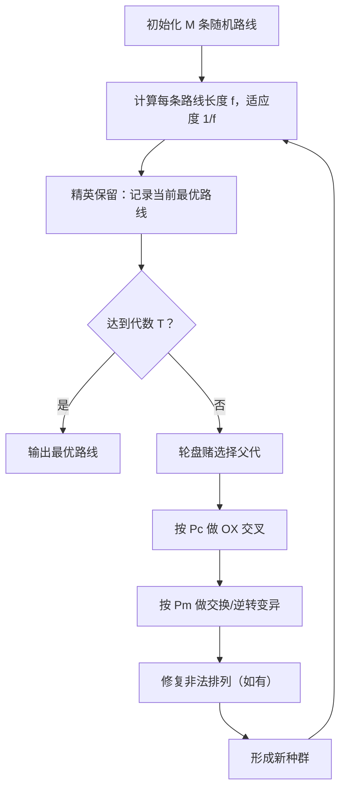

# 9.4 遗传算法求解 TSP 与应用

## 9.4.1 TSP 回顾

旅行商问题（TSP）：一个商人从所在城市出发，到若干城市推销商品，最后回到出发城市。如何选择一条周游路线，使商人经过每个城市一次且仅一次，且走过的路径最短？

给定 $n$ 个城市及距离矩阵 $D=(d_{ij})$，求一个排列 $\pi=(\pi_1,\pi_2,\dots,\pi_n)$，使

$$f(\pi)=\sum_{i=1}^{n-1}d_{\pi_i,\pi_{i+1}}+d_{\pi_n,\pi_1}$$

最小。TSP 是 NP 难问题，城市数较大时精确算法（DP、分支限界）不可行，遗传算法是常用的近似方法。

## 9.4.2 编码：排列编码

TSP 的解天然是一个排列，因此采用**排列编码**：染色体就是城市的访问顺序。

通常固定起点为城市 1，只编码其余 $n-1$ 个城市。例如 10 个城市的一条路线：

```text
1 → 2 → 8 → 5 → 3 → 7 → 6 → 4 → 10 → 9 → 1
```

染色体为 $(2,8,5,3,7,6,4,10,9)$。

::: warning 不要用普通二进制编码
若把城市编号用二进制表示，交叉/变异后可能产生重复城市或缺失城市，需要大量修复。排列编码配合专用交叉算子（OX、PMX）更自然。
:::

## 9.4.3 适应度函数

TSP 是最小化问题，适应度可取

$$F(\pi)=\frac{1}{f(\pi)}$$

其中 $f(\pi)$ 是路线总长度。路线越短，适应度越高。

为避免除零（虽然实际不会），也可以取

$$F(\pi)=MAX-f(\pi)$$

其中 $MAX$ 是一个足够大的常数。

::: tip 适应度缩放
若某条路线特别短，$1/f$ 会让它的适应度远高于其他个体，轮盘赌几乎只选它，导致早熟。可以对 $f$ 做排序选择，或使用 $F=1/f^2$、线性缩放等方式调节选择压力。
:::

## 9.4.4 交叉算子

### 为什么不能单点交叉

设父代

```text
P1: 2 8 5 | 3 7 6 4 10 9
P2: 4 6 3 | 8 9 10 2 7 5
```

若直接交换后段：

```text
子代: 2 8 5 | 8 9 10 2 7 5
```

城市 8、2、5 重复，城市 3、4、6 缺失——不是合法排列。

### 顺序交叉（OX）

1. 随机选两个交叉点，把父代 1 的中间段复制到子代相同位置；
2. 从父代 2 的第二个交叉点之后开始，按顺序扫描，把未出现在子代中的城市依次填入子代的剩余位置（绕回开头）。

```text
P1: 2 8 5 | 3 7 6 | 4 10 9
P2: 4 6 3 | 8 9 10 | 2 7 5

子代初始: _ _ _ | 3 7 6 | _ _ _
从 P2 的 10 之后扫描: 2,7,5,4,6,3,8,9,10
跳过已在子代中的 3,7,6，得到: 2,5,4,8,9,10
填入: 2 5 4 | 3 7 6 | 8 9 10
```

得到的子代是合法排列。

### 部分匹配交叉（PMX）

1. 复制父代 1 的中间段；
2. 对中间段建立“位置映射”；
3. 用父代 2 填充其余位置，若冲突则按映射替换。

PMX 能更好地保留位置信息，适合排列问题。

### 修复操作

若交叉算子产生了重复基因，可以用“修复”把它变回合法排列。课件给出的修复过程：

```text
待修复: Π = {2, 8, 5, 3, 8, 5, 3, 10, 9}
扫描 Π，只保留每个基因第一次出现，重复的置 0：
Π1 = {2, 8, 5, 3, 0, 0, 0, 10, 9}
统计缺失的基因（城市 1 固定，编码范围 2..10）：
缺失 = {4, 6, 7}
将缺失基因打乱，例如 {7, 4, 6}，依次填入 0 的位置：
Π2 = {2, 8, 5, 3, 7, 6, 4, 10, 9}
```

::: tip 修复 vs 专用交叉
修复操作简单通用，但可能破坏父代的优良结构；OX/PMX 等专用算子从设计上保证合法性，通常效果更好。工程中常两者结合：先用 OX，若仍有冲突再修复。
:::

## 9.4.5 变异算子

排列编码的变异不能简单“位取反”，常用：

| 变异 | 做法 | 特点 |
| :--- | :--- | :--- |
| 交换变异 | 随机交换两个位置 | 简单，局部扰动小 |
| 逆转变异 | 反转一段子序列 | 适合 TSP，可消除交叉边 |
| 插入变异 | 把一个城市移到另一个位置 | 改变顺序，扰动中等 |
|  scramble 变异 | 打乱一段子序列 | 扰动大，探索强 |

```python
def swap_mutation(chrom, pm):
    if random.random() < pm:
        i, j = random.sample(range(len(chrom)), 2)
        chrom[i], chrom[j] = chrom[j], chrom[i]
    return chrom
```

::: info 逆转变异与 2-opt
逆转变异（反转路径中的一段）本质上对应 TSP 的 **2-opt** 局部搜索操作：它把两条交叉的边替换为两条不交叉的边，通常能缩短路径。因此逆转变异在 TSP 中特别有效。
:::

## 9.4.6 完整算法流程



```python
def ga_tsp(cities, M=100, T=500, pc=0.8, pm=0.02):
    pop = [random_permutation(cities) for _ in range(M)]
    best = min(pop, key=route_length)
    for t in range(T):
        fitness = [1.0 / route_length(ind) for ind in pop]
        new_pop = [best]                      # 精英保留
        while len(new_pop) < M:
            p1 = roulette_select(pop, fitness)
            p2 = roulette_select(pop, fitness)
            c1, c2 = order_crossover(p1, p2, pc)
            swap_mutation(c1, pm)
            swap_mutation(c2, pm)
            new_pop.extend([c1, c2])
        pop = new_pop[:M]
        cur = min(pop, key=route_length)
        if route_length(cur) < route_length(best):
            best = cur
    return best
```

### 复杂度

- 每条路线长度计算 $O(n)$；
- 每代评价 $M$ 个个体，$O(Mn)$；
- 选择、交叉、变异各 $O(Mn)$；
- 总复杂度 $O(TMn)$。

对 $n=100$、$M=100$、$T=500$，约为 $5\times10^6$ 次基本操作，普通计算机瞬间完成。

## 9.4.7 提高 TSP 求解质量的技巧

1. **2-opt 局部搜索**：对每个子代做若干次 2-opt 改进，形成混合遗传算法；
2. **精英保留 + 锦标赛选择**：降低随机性，保护优良个体；
3. **自适应变异**：多样性低时增大 $P_m$；
4. **初始种群启发式**：用最近邻、贪心构造部分个体，提高起点质量；
5. **多种群/岛屿模型**：并行搜索不同区域，定期迁移；
6. **边组装交叉（EAX）**：直接继承父代的边集合，TSP 上效果很好。

::: warning GA 不保证最优
对 TSP，GA 通常能得到接近最优的解，但不能保证最优。若城市数较小（如 $n\le20$），应使用动态规划（$O(n^22^n)$）或分支限界求精确解；若 $n$ 很大，GA、模拟退火、蚁群算法等启发式方法更合适。
:::

## 9.4.8 遗传算法的应用总结

| 应用领域 | 具体问题 | 编码方式 |
| :--- | :--- | :--- |
| 组合优化 | TSP、背包、装箱、图着色 | 排列/二进制/整数 |
| 生产调度 | 车间调度、流水线调度、任务分配 | 排列/整数 |
| 函数优化 | 多峰函数、约束优化 | 实数/二进制 |
| 自动控制 | 控制器参数、模糊规则、神经网络结构 | 实数/二进制 |
| 机器学习 | 特征选择、超参数搜索 | 二进制/实数 |
| 图像处理 | 图像分割、恢复、特征提取 | 二进制/实数 |
| 工程设计 | 结构优化、电路设计、路径规划 | 混合编码 |

::: tip 遗传算法的“三板斧”
1. **编码**：把解表示成可交叉、可变异的染色体；
2. **适应度**：把目标函数转成“越大越好”的评价；
3. **算子**：选择保留优良基因，交叉组合优良片段，变异引入多样性。

抓住这三点，任何新问题都可以尝试套用 GA。真正决定效果的，是编码与算子是否贴合问题结构。
:::
